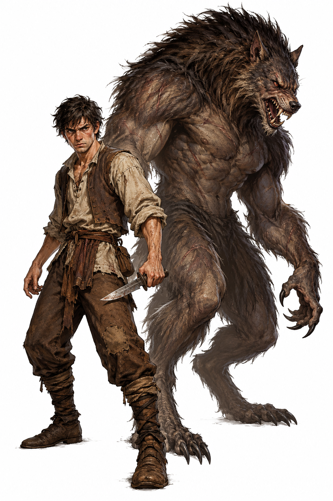
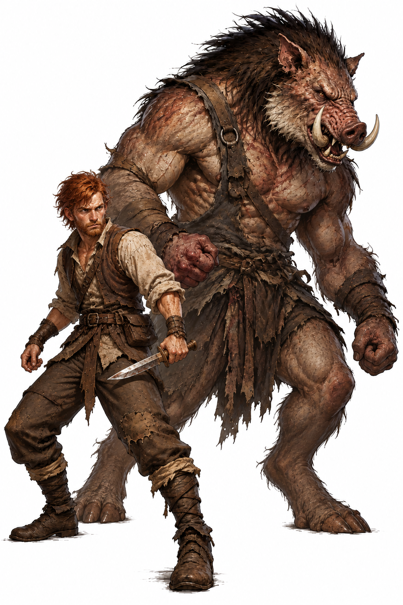
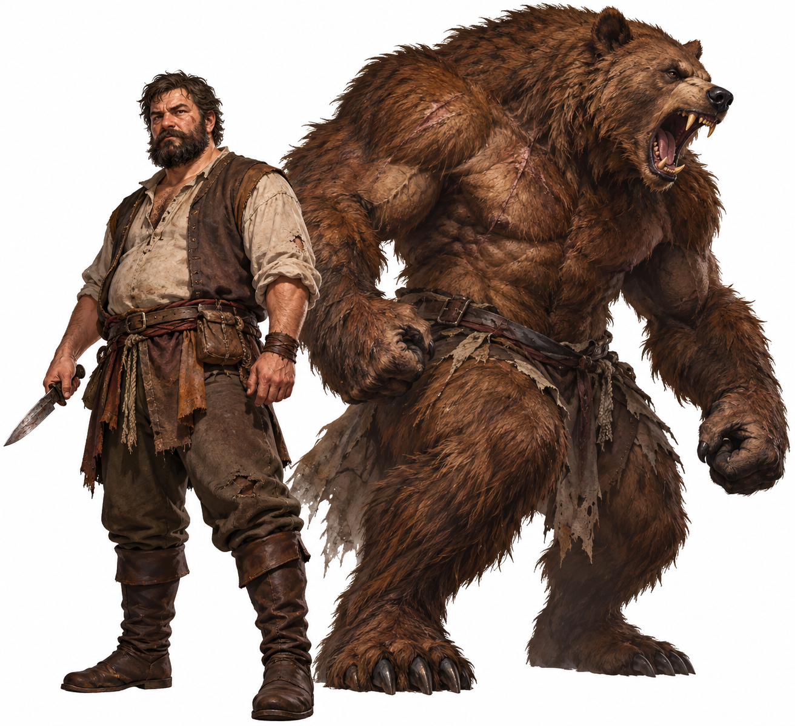
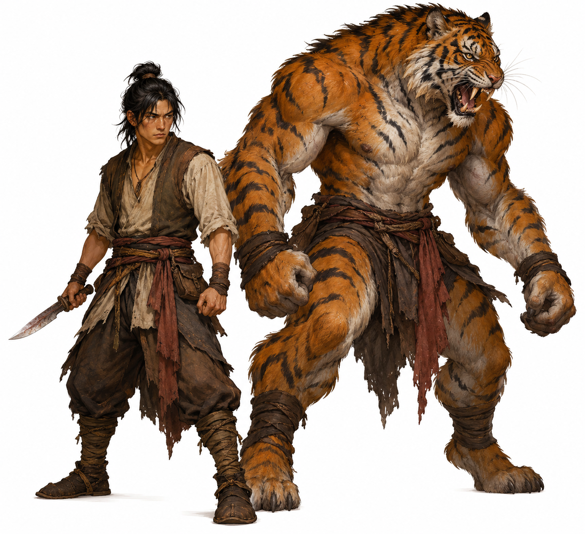
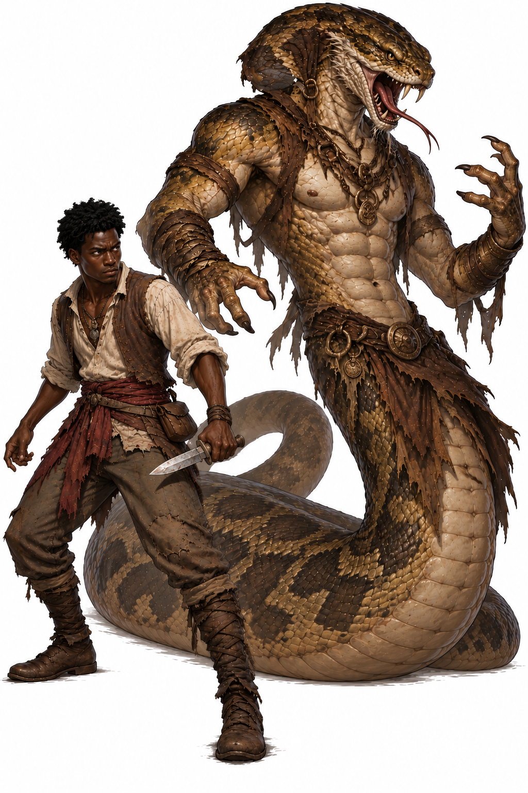
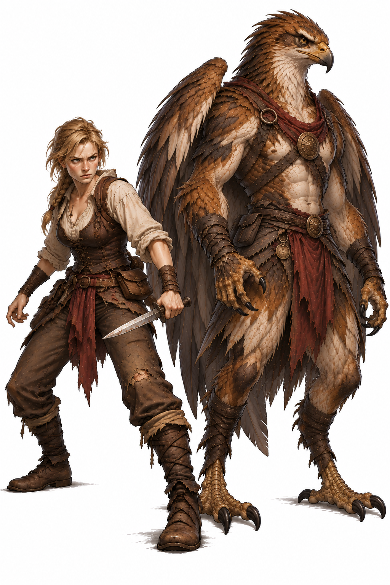

# Lobisomem (meio-homem, meio-lobo) - 71 pts

*Forma humana e forma lobisomem do mesmo personagem.*

## Lobisomens

Poucos em Yrth já viram um lobisomem de verdade, e a maioria dos que viram não viveu para contar. Os licantropos comuns do
reino, os homens-lobo, os homens-urso e os homens-javali, viram animais de verdade e passam a vida escondendo o que são. Os
**lobisomens** são outra coisa: uma linhagem **rara**, de criaturas bípedes e peludas, metade homem e metade fera, que as
lendas de Caithness, de Mégalos e das matas do oeste chamam de "o bicho que anda em pé". Eles **vêm de homens**, e os
homens só chegaram a Yrth com o Cataclismo, então nenhum lobisomem é mais velho que ele. De onde vem o gene, ninguém sabe: a
Igreja fala em maldição, e os sábios de Mégalos falam em experiências de feiticeiros. O que as histórias antigas dizem é
que, nos primeiros tempos depois da chegada, eles foram muitos, viveram em vilas e travaram uma guerra terrível contra os outros povos de meio
homem e meio bicho (ver **A Guerra da Fúria**, adiante).

**Origem do nome:** *lobisomem* é a velha palavra portuguesa para o homem-lobo, de *lobo* mais *homem* (a forma antiga é *lobisomem* ou *lobishomem*, a mesma
ideia do *loup-garou* francês e do *werewolf* inglês, "homem-lobo"). Em Yrth é o nome que o povo deu à linhagem, e o que ficou para todos os parentes dela.

Hoje eles **não têm sociedade**. Cada lobisomem vive e morre quase sempre sozinho, e encontrar outro é tão raro que muitos passam a
vida inteira sem ver um igual. Quando dois ou três se cruzam, às vezes se juntam numa **matilha**, que dura enquanto durar a
confiança entre eles, mas nunca formam uma aldeia, uma vila ou uma cidade. Entre os homens, o povo comum os confunde com os
lobos de verdade.

O lobisomem **já nasce assim**: a criança parece comum, filha dos pais e do povo onde cresce. Mas o gene é caprichoso. Os
**filhos de um lobisomem não necessariamente o herdam**, e ele pode saltar gerações ou aparecer numa criança de pais comuns que
nunca souberam o que carregavam. A fera só desperta na **adolescência**. Por volta dos treze ou catorze anos chega a
primeira lua cheia depois da puberdade, e o corpo se parte: o jovem sente dor, fome e raiva até que a forma de lobisomem
rompe a pele. A primeira transformação costuma ser a pior: ele não se reconhece, não controla a fera e, muitas vezes, fere
quem estava perto. As famílias que sabem o que esperar preparam o rapaz com antecedência. As que não sabem o enterram, o
expulsam ou o entregam à Igreja.

*Vantagens e Desvantagens:* na forma humana, o lobisomem é um homem ou uma mulher como outro qualquer. Na **forma de
lobisomem** fica enorme, forte e rápido, com o couro grosso e a resistência de um urso, e ignora a dor dos ferimentos.
Tem garras e dentes afiados, cai de pé como um gato, vê no escuro, tem faro e ouvido de lobo e corre, de quatro, o dobro do
que corre qualquer homem. Os ferimentos se fecham sozinhos, uma hora de cada vez, mas só enquanto a fera está de pé. Em troca,
a mente fica turva e animal, a fala se perde (ele ainda entende o que lhe dizem) e a postura é meio curvada. Na forma humana ele **esconde o que é**; quem vê a
transformação ou a forma de lobisomem entra em **pânico**, e quem **descobre o que ele é** passa a tratá-lo muito pior
(**−4 de reação**), e isso **não passa quando ele volta a ser humano**. Ele sente prazer no sangue e cai na fúria com
facilidade, e a prata o fere como o fogo, causa o triplo de dano e estanca a regeneração. A transformação leva **três
segundos**, durante os quais ele fica indefeso, e **a roupa que não tirou se rasga**, menos a parte da virilha. Ele escolhe mudar quando quiser, **sem precisar de esforço nem de teste**, mas a fúria e a lua cheia o
obrigam. Mesmo quem resiste age como bicho na noite de lua cheia.

*Amigos e Inimigos:* a forma humana não desperta nada, mas quem descobre o que ele é nunca esquece. Os humanos que a
viram reagem com pânico e ódio, e a Igreja e os caçadores de monstros os perseguem sem trégua. Os elfos veem neles uma
ferida da natureza, e os anões os temem por causa da força e dos instintos. Os Orcs, que só respeitam a força, não os
encaram com rancor. Alguns druidas respeitam o povo-lobo como filho da lua e da floresta. Quando um lobisomem encontra
outro, os dois se estudam com cautela; a matilha, se formar, é leal, mas cada um desconfia de todos os demais.

*Preferências e Aversões:* o lobisomem prefere a mata fechada, o frio e a noite. Respeita a caça e a lealdade da matilha, quando
a tem, e despreza a mentira. Odeia correntes e, acima de tudo, a **prata**. Muitos passam a vida tentando provar que são mais
homens do que fera, e outros acabam aceitando a fera de uma vez.

## Modelo racial

Raça de personagem criada com o sistema de geração de raças do *GURPS Fantasy Folk* (3ª ed.) e com os
licantropos do *GURPS Fantasy* (`livros/gurps-fantasy-3ed/08-personagens.md`). Os custos vêm do *Fantasy Folk*
(`backup/547610572-GURPS-Fantasy-Folk-3º-Edicao-1.pdf`) e do *Módulo Básico*.

**A ideia:** o lobisomem tem **duas formas**. A **forma humana** é um personagem humano comum (atributos, perícias
e vantagens pagos normalmente, sem custo racial). A **forma lobisomem** é um bípede semiereto, forte e feroz,
que só fala como humano na outra forma. O custo de 71 pontos é o da raça inteira, forma lobisomem e transformação
incluídas.

> O *Fantasy Folk* **não tem regra de forma alternativa** (só Morfose, 40 pts, que copia criaturas). O desconto
> de −30% pelas vantagens e desvantagens que só valem na forma lobisomem é **regra da casa**, não do livro.

## Resumo dos custos

| | Pontos |
|---|---|
| **Bloco A**: traços só da forma lobisomem, com −30% | 91,35 |
| **Bloco B**: traços das duas formas | −20 |
| **Total** | 71,35 → **71** |

Sem o desconto de forma, o modelo custaria 110,5 (130,5 do Bloco A menos 20 do Bloco B).

## Bloco A: só na forma lobisomem (−30% em tudo)

Limitação especial da casa: **"Só na forma lobisomem", −30%**, aplicada às vantagens **e** às desvantagens deste bloco
(a forma é voluntária, leva 3 turnos para mudar e deixa o personagem mudo).

| Traço | Base | Com −30% | De onde vem |
|---|---|---|---|
| **ST +3** | 30 | 21 | MB, modificador racial (+1 = 10 pts) |
| **DX +2** | 20 | 14 | idem |
| **HT +3** | 30 | 21 | idem |
| **IQ −3** | −30 | −21 | idem |
| **Garras** | 40 | 28 | Folk: garras de 15 a 30 cm, dano de GdP e GeB |
| **Dentes Afiados** | 5 | 3,5 | Folk: corte pela ST, só em combate de perto |
| **Queda de Gato** | 10 | 7 | Folk: subtrai 5 m da queda; DX bem-sucedida corta o dano pela metade |
| **Deslocamento Ampliado ×1 (correndo)** | 8 | 5,6 | Folk: 10 pts por nível, já com −20% por só valer **de quatro patas** |
| **Pontos de Vida Extra +3** | 15 | 10,5 | Folk: 5 pts por PV (o *Fantasy* usa 8 por PV) |
| **Olfato/Paladar Aguçados +3** | 6 | 4,2 | Folk: 2 pts por nível |
| **Audição Aguçada +2** | 4 | 2,8 | Folk: 2 pts por nível |
| **Rijeza +1** | 10 | 7 | MB: RD 1 em todo o corpo (o Folk cobraria só 3 pts pela mesma RD; aqui vale a Rijeza do MB) |
| **Hipoalgia** | 10 | 7 | MB |
| **Visão Noturna** | 10 | 7 | Folk/MB: enxerga com qualquer pouca luz; na escuridão total continua cego |
| **Mudo** | −25 | −17,5 | MB/Folk: a forma não fala, mas entende a língua humana |
| **Semiereto** | −5 | −3,5 | Folk: marcha desajeitada em pé (−2 no Deslocamento); para trotar ou correr usa os quatro membros |
| **Regeneração Normal** (1 PV por hora), **−10%** (anulada na presença de prata) | 22,5 | 15,75 | Folk: 25 pts; já inclui Recuperação Alígera. **Só na forma lobisomem** (no *Fantasy* vale nas duas). Não restaura membros perdidos |
| **Sanguinolência** | −10 | −7 | MB: teste de Vontade para aceitar rendição ou fazer prisioneiro |
| **Aparência: Hedionda** | −20 | −14 | MB `02-criacao-de-personagem.md`: **−4 em todo teste de reação** (exceto de criaturas alienígenas ou de quem não o vê). O Folk usa "Aparência Hedionda (−20)" em raças. Só na forma lobisomem: na forma humana ele esconde o que é |
| **Total** | **130,5** | **91,35** | |

## Bloco B: nas duas formas

| Traço | Pontos | De onde vem |
|---|---|---|
| **Transformação voluntária** | +5 | *Fantasy*: poder mudar de forma quando quiser |
| **Fúria** | −15 | MB |
| **Vulnerabilidade a prata** (Raro, 2 níveis): dano ×3 | −10 | Folk: Raro = −5 por nível |
| **Total** | **−20** | |

## Regras de jogo

### Transformação
- **Duração:** **3 turnos**, da forma humana para a de lobisomem e de volta (o *Fantasy* também diz 3 segundos).
- **Indefeso:** durante os 3 turnos ele não faz nada e **não pode usar defesa ativa**.
- **Voluntária (+5):** **sem teste de Vontade**: ele simplesmente decide mudar, quando quiser, e a transformação leva os 3 turnos.
- **Involuntária (sem custo em pontos):** a **Fúria** o transforma automaticamente. Nas fases da lua, faz teste de Vontade
  para resistir, e na **lua cheia** o teste tem **−5**. É só regra de jogo: a desvantagem de −4 que existia foi retirada.
- **Inconsciente ou morto:** volta à forma humana (*Fantasy*).
- **Ferimentos:** os ferimentos de uma forma passam para a outra. Se a HT humana for muito menor que a da fera, o
  personagem pode voltar gravemente ferido.
- **De quatro para duas patas** gasta 1 turno (é outra coisa, não é a transformação).
- **Roupas:** **toda roupa que não foi retirada antes da transformação se rasga**, e ele volta à forma humana em
  trapos. A **única exceção é a parte da virilha**, que se mantém do mesmo tamanho e **não se rasga**, então sobra o
  tapa-sexo no lugar. Repor a roupa custa $10 (classe baixa) ou $40 (classe média), pelo MB. As armaduras e as demais peças
  vestidas seguem a mesma lógica, e o Mestre decide o que estoura e o que só cai; armas, bolsas e o que ele leva na
  mão ficam com ele (se a forma puder segurar).
- **Opcional:** o Mestre pode acelerar a transformação causada pela Fúria sem mudar o custo, porque 3 turnos indefeso
  no meio de uma luta é uma pena pesada.

### Forma lobisomem
- **Bípede semiereto:** em pé, o Deslocamento tem **−2**. **De quatro** ele corre o **dobro** (Deslocamento Ampliado), mas
  de quatro conta como agachado ou ajoelhado e **não usa as mãos**; a mordida continua valendo.
- **Armas naturais:** **Garras** (GdP e GeB, em combate corpo a corpo; o Mestre decide o tipo de dano, corte por padrão) e
  **Dentes Afiados** (corte pela ST, combate de perto).
- **Mudo:** entende a língua humana, não fala. A DX serve só para lutar, não para abrir fechadura nem escrever.
- **Sanguinolência:** Vontade para aceitar rendição ou fazer prisioneiro.
- **Hipoalgia:** não fica atordoado nem perde DX por ferimento (exceto golpe na cabeça ou fulminante).
- **Sentidos de lobo:** Olfato/Paladar Aguçados +3 e Audição Aguçada +2 somam bônus nos testes de IQ para cheirar e
  ouvir (não valem para a visão). Valem só na forma lobisomem.
- **Visão Noturna:** vê bem com qualquer claridade fraca, mas na escuridão total continua cego.
- **Fúria:** enfurecido, faz Ataque Total, não é atordoado, e testa HT+4 para continuar vivo, até chegar a −5×HT.
- **IQ −3 na forma:** o teste de Vontade para sair da Fúria fica mais difícil.

### Prata
- **Dano ×3** de armas de prata ou revestidas de prata (regra da casa, no lugar do ×2 do *Fantasy*; equivale a 2 níveis
  de Vulnerabilidade).
- **A Regeneração é anulada** enquanto houver prata junto dele.
- Ele **manuseia prata sem se queimar**, como no *Fantasy*.
- Armas de prata custam **5×** (arma de mão, que quebra como arma barata) e flechas de prata custam **5×**.

### Terror e aparência
- **Aparência Hedionda (só na forma):** **−4 em todo teste de reação**, menos de criaturas alienígenas e de quem não o vê. Na
  forma humana ele passa por uma pessoa comum e **esconde o que é**.
- **Quem descobre não esquece (regra da casa, sem custo extra):** quem vê a transformação ou fica sabendo o que ele é
  passa a reagir com **−4**, e o redutor **não volta** quando ele retorna à forma humana. Quem não sabe de nada reage
  normalmente.
- **Verificação de Pânico** (MB, págs. 93-94; sem custo em pontos, é decisão do Mestre): cada testemunha comum faz teste de
  Vontade ao **ver a transformação ou a forma lobisomem**.
  - Redutor sugerido: **−2** (ou **−3** se for um amigo dele), dentro da faixa de −1 a −6 do MB.
  - **+5** se o confronto já tiver começado (calor da batalha); Reflexos em Combate dá +2.
  - Um teste por testemunha por cena. Quem falha rola na Tabela de Verificação de Pânico.
  - **Destemor** (Folk, 2 pts por nível) soma o nível à Vontade de quem o tem.
- **Comportamento na lua cheia (sem custo em pontos):** ele **age de forma animalesca na lua cheia, mesmo resistindo**. Mesmo que
  passe no teste de Vontade com −5 e não se transforme, fica inquieto e agressivo: fareja, rosna, não consegue ficar
  parado, mesmo na forma humana. É só interpretação, sem efeito mecânico (antes era uma peculiaridade de −1, retirada
  para fechar a raça em 70 pontos).

### Regeneração
**Só na forma lobisomem** (no *Fantasy* o licantropo regenera em qualquer forma; aqui é decisão da casa). 1 PV por hora, além da cura normal. Inclui Recuperação Alígera (+5 na HT para testes de recuperação). Não restaura
membros perdidos (isso é Restaurar Membros, 40 pts, que o modelo não tem).

## Decisões do desenho

- **Desdobramento de Personalidade** (MB, −10 ou −15) **ficou de fora**: a troca dele é involuntária, por teste de IQ,
  e exigiria duas planilhas com 50 pontos de diferença. Aqui a mente da fera já está em IQ −3, Fúria e Mudo.
- **Correções ao esboço original:** PV Extra custa 5 pts por PV (o esboço usava 10 pts), a RD sai a 3 pts (não 10) e o Mudo vale −25.
- **Sugestões do Folk para raça de PJ:** bônus máximo de +3 por atributo (cumprido); bônus total de até 50 pts
  (o modelo soma 80; a regra de compensação do Folk, "−1 para cada +2", pediria −4, e o IQ −3 cobre quase tudo).
- **Desvantagens raciais:** não contam contra o limite de desvantagens do personagem (**−55** nesta campanha). O Folk
  sugere, se a raça passa de −20 em desvantagens raciais, limitar as pessoais a −20 ou −30; aqui a raça passa disso
  (Mudo, IQ, Sanguinolência, Aparência Hedionda, Fúria, Vulnerabilidade). Fica a critério do Mestre.

## Variações de preço

| Variação | Total |
|---|---|
| Desconto de forma **−30%** (o deste modelo) | **71** |
| −20% | 84 |
| −40% | 58 |
| −50% | 45 |
| Sem desconto de forma | 111 (110,5) |
| RD do Folk (RD +1 por 3 pts) no lugar da Rijeza do MB | 66 |
| Cobrar também o "quem descobre não esquece" como Reputação −4 (−20) | 51 |
| Reputação −4 no lugar da Hedionda (a persistência paga, sem Hedionda) | 65 |
| Peculiaridade da lua cheia de −1 de volta | 70 |
| Regeneração nas duas formas (Bloco B, sem desconto) | 78 |
| Prata ×2 (1 nível, −5) em vez de ×3 | 76 |
| Com Desdobramento de Personalidade (−10) | 61 |
| Com a Transformação Involuntária de −4 de volta | 67 |
| HT +2 em vez de +3 | 64 |
| Prontidão +3 (15) no lugar dos sentidos de lobo | 75 |
| Aparência Feio (−10, reação −2) no lugar da Hedionda | 78 |
| Estigma Social −15 no lugar da Hedionda | 75 |
| Sem a Hedionda | 85 |

## Traços que combinam (não incluídos)

**Prontidão** (5 pts por nível, MB) foi trocada por Olfato/Paladar e Audição aguçados, só na forma. Combinaria também com
Rastreamento e Sobrevivência como perícias de lobo, mas elas são pagas pelo personagem, não pela raça.
Desvantagens mentais raciais citadas pelo Folk: Sanguinolência, Gula, Intolerância e Hábito Racial Detestável.

## Para a ficha (`criar-personagem`)

- **Linha da raça:** `Raça: Lobisomem`, custo **71**, com `"raca": true`.
- **`raca_tracos`**, curtos (custo `-`), como a skill pede:
  `ST +3, DX +2, HT +3, IQ -3 (forma)`; `Garras; Dentes Afiados`; `Queda de Gato; Visão Noturna`; `Olfato +3; Audição +2`;
  `Desl. Ampliado (4 patas)`; `PV +3; Rijeza 1`; `Hipoalgia; Sanguinolência`; `Regeneração (sem prata, só forma)`;
  `Fúria; Mudo; Semiereto`; `Hediondo (forma)`; `Prata ×3`; `Transformação 3 turnos`.
- **`raca_peculiaridades`:** nenhuma (o comportamento na lua cheia agora é só descrição, sem custo).
- Atributos, perícias e vantagens pessoais são pagos como os de um humano; o modificador racial só vale na forma
  lobisomem, e o personagem paga o atributo antes do modificador racial.

## A Guerra da Fúria

Os homens só chegaram a Yrth com o Cataclismo, ainda no século XI, e entre os arrancados de seus mundos já havia quem
carregasse o gene. Nas primeiras décadas depois da chegada, **não existia só o lobisomem**: havia vários povos de **meio
homem, meio bicho**, o povo-lobo, o povo-urso, o povo-javali e os de tigre, de águia e de cobra, e todos eram **muitos** e
**viviam em vilas**, como qualquer povo, com casas, famílias, caçadas e chefes. Foi o único tempo em que tiveram sociedade.

Então veio a **Guerra da Fúria**, uma guerra terrível **entre todos esses povos de meio homem e meio bicho**, com o nome da
fúria que tomava todos eles quando a lua cheia encontrava a ira. Quem a **ganhou** foram os **lobisomens**, mas a
vitória lhes custou quase tudo: as vilas viraram cinzas e o povo foi reduzido a **talvez uma centena** de sobreviventes,
espalhados pelas matas. Dos **outros povos de meio homem e meio bicho só sobraram os genes que já estavam espalhados**,
nos filhos mestiços que já andavam pelo mundo quando a guerra começou. Por isso o torc, o berserker e os demais são
**mais raros ainda** que o lobisomem: de um povo inteiro só resta o gene, que aparece sem aviso.

Foi a guerra que desfez a sociedade deles e que explica o que se vê hoje:

- **Por que há tão poucos:** de um povo de vilas restou uma centena de lobisomens, e eles nunca se reconstruíram. Dos outros
  só restam os genes.
- **Por que vivem sozinhos:** quem sobreviveu aprendeu a se esconder, e juntar muitos num só lugar traz de volta a fúria.
  Quando dois lobisomens se encontram, formam uma **matilha**, mas nunca mais uma vila.
- **Por que o gene é caprichoso:** os genes que ficaram espalhados nos outros povos aparecem de vez em quando, sem
  aviso, em crianças de pais comuns, e os filhos de um lobisomem **não necessariamente** os herdam.
- **Por que a lenda é nebulosa:** quase ninguém lembra da Guerra da Fúria. O povo comum a confunde com contos de lobos e
  de homens-fera, e a Igreja a trata como superstição.

*Para o Mestre:* os livros não trazem esta guerra, ela é criação desta raça. Os povos que lutaram são **os de meio homem e meio
bicho** (lobisomem, berserker, torc, harimau, naga e anzu, todos definidos em "Outras variações"). A **centena de
sobreviventes** é um número para a mesa: são poucos PdMs lobisomens possíveis em toda Yrth.

## Outras variações

As variações seguem a mesma lógica do lobisomem (**71 pontos**): o gene hereditário e caprichoso, a adolescência, a transformação de
3 segundos sem teste, as roupas rasgadas e as regras de pânico e de reação. **Cada uma mostra só o que muda.** Os pontos da tabela
de cada variação já estão com o desconto de forma de −30%.

### Torc (meio-homem, meio-javali) - 47 pts

*Forma humana e forma de torc do mesmo personagem.*

**Origem do nome:** vem do irlandês antigo *torc*, "javali". Nas lendas celtas, o javali é caça de heróis e animal de reis: há o *Torc Triath*, rei dos javalis
da Irlanda, e o galês *Twrch Trwyth*, um rei amaldiçoado que foi transformado em javali. Combina com a raça, que é bruta e forte.

O **torc** é o parente pesado do lobisomem, e é **mais raro ainda**: seu povo perdeu a **Guerra da Fúria** e dele só restam
os genes espalhados. Muitos sábios nem acreditam que exista, e o povo das matas o confunde com javalis monstruosos e com ogros.
É um bruto de couro duro como casco, **sem a agilidade** do lobisomem, e ataca com as **presas**, que perfuram. Não cai de pé como
um gato e **não tem sentidos apurados**. **Orcs e Ogros** não reagem mal a ele, e alguns já foram vistos nas **Terras dos Orcs**,
a oeste de Caithness, **vivendo entre eles na forma de javali**: os Orcs, que só respeitam a força, o aceitam como mais um bruto do
bando, e os Ogros o tratam como um igual.

**O que muda:**

- **ST +4, DX não muda, IQ −3, HT +4** (no lugar de ST +3, DX +2, IQ −3, HT +3) e **+4 PV** extras (no lugar de +3).
- **Presas** (perfuração, pela ST) no lugar de Garras e Dentes Afiados.
- **Rijeza +2** no lugar da Rijeza +1.
- **Sem Queda de Gato** e **sem sentidos apurados** (nem Olfato, nem Audição, nem Visão Noturna).
- **Sem redutor de reação com Orcs e Ogros:** a Aparência Hedionda (−4) e o "quem descobre não esquece" não valem com eles.

| Muda | Lobisomem | Torc | Diferença (−30%) |
|---|---|---|---|
| ST | +3 (30) | +4 (45) | +10,5 |
| DX | +2 (20) | não muda (0) | −14 |
| HT | +3 (30) | +4 (45) | +10,5 |
| Garras | 40 | sem | −28 |
| Armas naturais: dentes | Dentes Afiados (5) | Presas (10) | +3,5 |
| PV Extra | +3 (15) | +4 (20) | +3,5 |
| Queda de Gato | 10 | sem | −7 |
| Olfato, Audição e Visão Noturna | 20 | sem | −14 |
| Rijeza | +1 (10) | +2 (25) | +10,5 |
| **Total** | **71** | **47** | **−24,5** |

**Observações:**

- O máximo sugerido pelo *Fantasy Folk* para raça de PJ é +3 por atributo, e o torc tem **ST e HT +4**: é PdM ou exige aprovação.
- "Sem alteração nos sentidos" foi lido como também sem a **Visão Noturna**. Se ele deve ver no escuro, são +7 pontos (54).
- No *Folk*, "Dentes Afiados" cortam. A perfuração é a **Presas (10)**.
- Orcs e Ogros **não mudam o preço**: o *Fantasy* manda ignorar o redutor de reação que não vale para a maioria das raças que a raça encontra.

### Berserker (meio-homem, meio-urso) - 124 pts

*Forma humana e forma de berserker do mesmo personagem.*

**Origem do nome:** vem do nórdico antigo *berserkr*, normalmente lido como "camisa de urso" (*ber*, urso, e *serkr*, camisa): os guerreiros que lutavam
vestidos com peles de urso e entravam em **fúria** de batalha, sem sentir dor. Combina com a raça, que é bruta e tem **Fúria**. (Outra leitura de *ber*
é "nu", o guerreiro sem armadura.)

O **berserker** (metade homem, metade urso) é o bruto da família: **o dobro da força**, o couro grosso e uma postura **ereta, sem a curvatura**
do lobisomem. É **imenso**: roupas, armas e ferramentas comuns não servem nele. Também perdeu a **Guerra da Fúria**, e dele só restam
os genes espalhados, o que o torna raríssimo. **Não tem a agilidade** do lobisomem e **não cai de pé** como um gato.

**O que muda:**

- **ST ×2** (o dobro da ST humana), **DX não muda**, HT +3 e IQ −3 (no lugar de ST +3 e DX +2), e **+6 PV** extras (no lugar de +3).
- **Rijeza +2** no lugar da Rijeza +1.
- **Sem Queda de Gato** e **sem Semiereto** (postura normal, sem o −2 no Deslocamento; a corrida de quatro continua).
- **Tamanho Inconveniente** (novo): na forma, roupas, armas, armaduras e ferramentas comuns não servem, só as sob medida. O Folk
  manda pagar **pelo menos o dobro** por armas feitas para a ST dele, e a armadura também é mais cara.

| Muda | Lobisomem | Berserker | Diferença (−30%) |
|---|---|---|---|
| ST | +3 (30) | ×2, ST racial 20 (110) | +56 |
| DX | +2 (20) | não muda (0) | −14 |
| PV Extra | +3 (15) | +6 (30) | +10,5 |
| Rijeza | +1 (10) | +2 (25) | +10,5 |
| Queda de Gato | 10 | sem | −7 |
| Semiereto | −5 | sem | +3,5 |
| Tamanho Inconveniente | sem | −10 | −7 |
| **Total** | **71** | **124** | **+52,5** |

**Observações:**

- **"ST ×2" e o preço:** o dobro da ST não é um bônus fixo. Tratei como ST racial 20 e usei o **ST Ampliado do Folk** (110 pts), mais barato que
  a tabela do MB (+10 = 175; com ela o total seria 169). Com a limitação **Natural** do Folk (−40% acima de ST 15) seria 110.
- O máximo sugerido pelo Folk é +3 por atributo: é PdM ou exige aprovação do Mestre.
- **Tamanho Inconveniente** vale só na forma, com o desconto de −30%. O Mestre decide o tamanho e o peso exatos (o Homem-Urso do
  *Fantasy* pesa o quádruplo).

### Harimau (meio-homem, meio-tigre) - 78 pts

*Forma humana e forma de harimau do mesmo personagem.*

**Origem do nome:** vem do malaio *harimau*, "tigre". Nas lendas da Malásia e de Sumatra, o *harimau jadian* ("tigre que se tornou") é o homem que vira tigre,
feiticeiro ou amaldiçoado, e que vive escondido entre as aldeias. Combina com a raça, que é o parente felino do lobisomem.

O **harimau** (metade homem, metade tigre) é o parente **felino** do lobisomem e é **muito parecido com ele**: a única diferença de jogo é a
**destreza**, ainda maior na forma de fera. Também perdeu a **Guerra da Fúria**, e dele só restam os genes espalhados.

**O que muda:** só a **DX +3** (no lugar de +2).

| Muda | Lobisomem | Harimau | Diferença (−30%) |
|---|---|---|---|
| DX | +2 (20) | +3 (30) | +7 |
| **Total** | **71** | **78** | **+7** |

O harimau chega ao máximo sugerido pelo Folk (+3 por atributo) em ST, DX e HT.

### Naga (meio-homem, meio-cobra) - 52 pts

*Forma humana e forma de naga do mesmo personagem.*

**Origem do nome:** vem do sânscrito *nāga*, "serpente": na mitologia hindu e budista, os nagas são seres-serpente, muitas vezes com torso humano e cauda de cobra,
guardiões de águas e tesouros, de veneno mortal. Combina com a raça, que tem o corpo de cobra, veneno e constrição.

O **naga** (metade homem, metade cobra) é o mais diferente da família. Também perdeu a **Guerra da Fúria**, e dele só restam os
genes espalhados, o que o torna raríssimo. Da cintura para cima é um homem escamoso, de braços com garras; da cintura para baixo
**não tem pernas**: tem uma **cauda de serpente** de uns 2 m, e **move-se rastejando**. Morde com presas que perfuram e injetam
**veneno**, e **estrangula com a cauda** (constrição). A postura é normal (ereto, sem a curvatura do lobisomem). Na transformação,
**até a parte da virilha se rasga**.

**O que muda:**

- **ST +2, DX não muda, IQ −3, HT +2** (no lugar de ST +3, DX +2, IQ −3, HT +3) e **só +2 PV** extras (no lugar de +3).
- **Sem pernas, move-se rastejando** (ver abaixo). Sem Deslocamento Ampliado (corrida de quatro patas) e **sem Semiereto**. **Sem Queda de Gato**.
- **Garras só de contusão**, no lugar das Garras de corte do lobisomem.
- **Presas**: a mordida causa dano por **perfuração**, no lugar do Dentes Afiados.
- **Veneno peçonhento** na mordida (novo).
- **Ataque por constrição** com a cauda (novo).
- **Roupas:** **toda** roupa que não foi tirada se rasga, **inclusive a parte da virilha** (sem exceção).

| Muda | Lobisomem | Naga | Diferença (−30%) |
|---|---|---|---|
| ST | +3 (30) | +2 (20) | −7 |
| DX | +2 (20) | não muda (0) | −14 |
| HT | +3 (30) | +2 (20) | −7 |
| PV Extra | +3 (15) | +2 (10) | −3,5 |
| Garras | 40 (corte) | 15 (contusão) | −17,5 |
| Dentes | Dentes Afiados (5) | Presas (10), perfuração | +3,5 |
| Veneno peçonhento (nível 2) | sem | 30 | +21 |
| Constrição (cauda): Flexibilidade Extra 5 + Ataque Constritor 15 | sem | 20 | +14 |
| Deslocamento Ampliado (de quatro) | 8 | sem | −5,6 |
| Semiereto | −5 | sem | +3,5 |
| Queda de Gato | 10 | sem | −7 |
| **Total** | **71** | **52** | **−19,6** |

**A cauda e o rastejar, no *Fantasy Folk***

O Folk **não tem uma desvantagem ou vantagem "sem pernas"**: a aparência é só "efeito especial", e a raça paga só pelas consequências de jogo.
O que ele traz sobre cauda e membros:
- **Pernas** (`Geração de Raças`): "se um membro não pode manipular, mas pode pisar, é uma perna". Duas pernas custam 0. Uma raça **sem pernas**
  não tem valor próprio: o naga **rasteja** com a cauda no Deslocamento normal, **sem pontos**, mas **não chuta nem pisoteia**.
- **Golpeador** (5 pts): um membro que acerta (teste de DX) mas não manipula nem anda, como "uma cauda esmagadora". Causa dano de GdP, em combate
  corpo a corpo. **Não incluí**: a cauda dele ataca por constrição. Se quiser também o golpe de cauda, são +5 (3,5 com o desconto).
- **Membro extra sem ataque físico** (5 pts): uma cauda preênsil que só segura, como a de um macaco. Também não incluí.
- **Flexibilidade Extra** (5 pts para um membro) e **Ataque Constritor** (15 pts): são o que permite a constrição. Foi o que usei.
- **Horizontal** (−10, postura de cão ou gato) não se aplica: ele fica ereto, e a postura "curvada" é o Semiereto, que ele não tem.

**Constrição, em detalhe** (Folk, `Geração de Raças`, "Ataques Constritores")

1. **Custo:** 20 pontos, sendo 5 pela **Flexibilidade Extra da cauda** (o membro que se enrola) e 15 pelo **Ataque Constritor**.
2. **Agarrar primeiro:** o naga precisa **agarrar com sucesso** o oponente com a cauda, como no combate de perto do MB (Segurar). Sem o agarrão não há constrição.
3. **Disputa Rápida de ST:** depois do agarrão, ele rola uma **Disputa Rápida de ST** contra o oponente.
   - **Se o naga vencer**, a vítima sofre dano. O Folk diz "tanto dano quanto perdeu": entendo como **dano igual à margem da vitória**,
     como o Estrangular do MB.
   - **Se a vítima vencer**, ela **não sofre dano**.
4. **Tamanho do alvo:** para constringir, a cauda precisa ter **o dobro, em hexágonos, do tamanho da vítima**. A vítima humana (1 hex)
   exige uma cauda de pelo menos **2 hexágonos**, que é o caso. Um alvo de 2 hexes, como um cavalo ou um ogro, exige 4 hexes, e o
   naga **não os constringe**. O naga ocupa **3 hexágonos** (1 do torso mais 2 da cauda); o Homem-Cobra do *Fantasy* tem 4.
5. **Enquanto constringe:** a cauda fica ocupada e o naga continua com os **braços e a mordida** livres. O Mestre decide as penalidades
   de lutar com uma vítima agarrada. A vítima presa só se solta pelas regras de Desvencilhar do MB.
6. **Dano que dura:** a constrição repete a Disputa de ST a cada turno enquanto ele mantiver o agarrão.

**Veneno peçonhento** (15 pts por nível; nível 2 = 30)

- **Como age:** o veneno **peçonhento** entra no sangue (não é ácido). Quando é liberado pela primeira vez, e depois **a cada hora**, a vítima
  testa **HT − 2** (o nível). **Falhou:** sofre **2d** de dano (1d por nível). **Passou:** o veneno acabou e ela não precisa testar mais.
- **Entrega:** qualquer **mordida bem-sucedida que atravesse a armadura** libera o veneno, **com dano ou sem**. As presas já estão incluídas.
  A armadura protege contra a entrega, mas não contra o veneno que já está no sangue.
- **Dano da mordida:** o veneno **não aumenta** o dano da mordida: ela segue a perfuração das **Presas**.

**Garras (15 pts, contusão):** a Garras mais barata do Folk dá **+2 de dano extra em socos e chutes**. Como soco é contusão, as garras do naga
**só causam contusão**, e as de 40 pontos do lobisomem (que cortam) não valem aqui. Sem pernas, só os socos.

**Observações:**

- A visão, o olfato, a Rijeza, a Hipoalgia, a regeneração, o Mudo, a Sanguinolência e a Hedionda continuam como no lobisomem.
- **Presas e Veneno** somam: o Folk inclui as presas no veneno, então parte das Presas (10) é redundante. Mantive as duas porque você quer a
  mordida por perfuração e o veneno.
- **Veneno nível 1** (15 pts) deixaria o naga em **41**; **nível 3** (45 pts) em **62**.

### Anzu (meio-homem, meio-águia) - 76 pts

*Forma humana e forma de anzu do mesmo personagem.*

**Origem do nome:** vem da Mesopotâmia: *Anzu* (ou *Imdugud*, em sumério) é o pássaro gigante das tempestades, uma ave de rapina com asas imensas,
que roubou a Tábua dos Destinos do deus Enlil e foi caçado por ele. Combina com a raça, a única da família que voa.

O **anzu** (metade homem, metade águia) é o único da família que **voa**. Também perdeu a **Guerra da Fúria**, e dele só restam os
genes espalhados, o que o torna raríssimo. Na forma de fera tem **asas grandes** e plumagem, **bico** que perfura e **garras** que cortam,
e é **ágil** (DX alta), mas menos forte e menos resistente que o lobisomem. **Voa**, mas **não com a velocidade de uma águia de verdade**:
o voo é de gente alada, no ritmo de quem corre.

**O que muda:**

- **ST +2, DX +3, IQ −3, HT +2** (no lugar de ST +3, DX +2, IQ −3, HT +3) e só **+2 PV** extras (no lugar de +3).
- **Voo Alado** (novo): asas e voo, **com a velocidade do Folk, e não a de uma águia** (ver abaixo).
- **Bico** (Presas): dano por **perfuração**, no lugar do Dentes Afiados. As **Garras** continuam **por corte**, como no lobisomem.
- **Sem Deslocamento Ampliado de quatro patas, sem Queda de Gato e sem Semiereto**: ele anda ereto sobre duas pernas e voa.

| Muda | Lobisomem | Anzu | Diferença (−30%) |
|---|---|---|---|
| ST | +3 (30) | +2 (20) | −7 |
| DX | +2 (20) | +3 (30) | +7 |
| HT | +3 (30) | +2 (20) | −7 |
| PV Extra | +3 (15) | +2 (10) | −3,5 |
| Dentes | Dentes Afiados (5) | Bico = Presas (10), perfuração | +3,5 |
| Voo Alado (Voo 40, −25%) | sem | 30 | +21 |
| Deslocamento Ampliado (quatro patas) | 8 | sem | −5,6 |
| Queda de Gato | 10 | sem | −7 |
| Semiereto (desvantagem) | −5 | sem | +3,5 |
| **Total** | **71** | **76** | **+4,9** |

**O voo, no *Fantasy Folk*** (`Geração de Raças`, "Voo")

- **Custo:** o **Voo** custa 40 pontos, e a limitação especial **Voo Alado** reduz em 25%, então **30**.
- **Velocidade:** a velocidade de voo é **o dobro do Deslocamento normal**. É por isso que ele **não voa como uma águia**: a águia do
  *Fantasy* (o Homem-Águia) voa a **20**, muito acima. Para chegar perto disso, ele compra **Deslocamento Ampliado (Voo)**, que dobra a velocidade
  de voo por nível (10 pts, 7 com o desconto). Não está comprado.
- **Asas:** a envergadura deve ser **pelo menos o dobro da altura**, e maior se o corpo for grande ou pesado (o Homem-Águia do *Fantasy* tem 3,65 m).
  Para **decolar, pousar e manobrar** ele precisa de uma **área aberta com raio igual à envergadura**. Com as asas amarradas, ou uma
  aleijada, **não voa**.
- **Pairar:** pode pairar e voar tão alto quanto quiser, desde que tenha ar para respirar.
- **Sem acrobacias:** a vantagem não dá curvas fechadas nem manobras complexas, que ficam na **perícia Voo (Alado)** (Física/Média, pré-definida
  na DX para quem voa naturalmente, a perícia de um anzu).
- **Combate em voo** (Folk): atacar **com arma** em voo tem **−4** (o dobro se a perícia Voo for menor que a DX); **ataques naturais (bico e garras)
  não têm o −4**. Voando, a **Esquiva ganha +2** e é calculada pela Velocidade Básica, não pelo Deslocamento de voo.

**Observações:**

- O resto é igual ao lobisomem.
- **Voo à velocidade de uma águia** (Deslocamento Ampliado (Voo) ×1) deixa o anzu em **83**.
- **Voo Alado só na forma de fera**, com o desconto de −30%. Na forma humana ele não voa.

