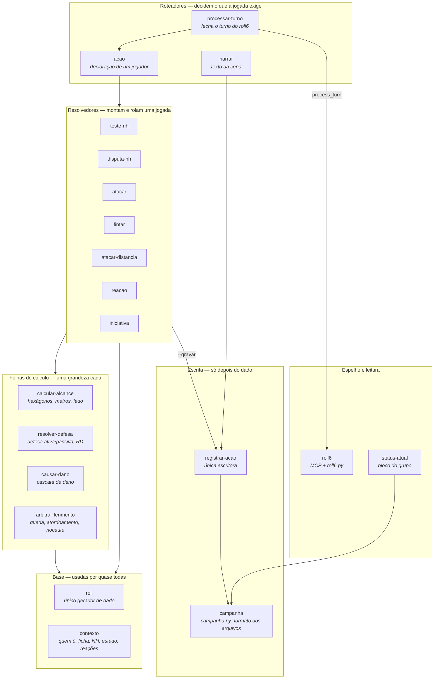
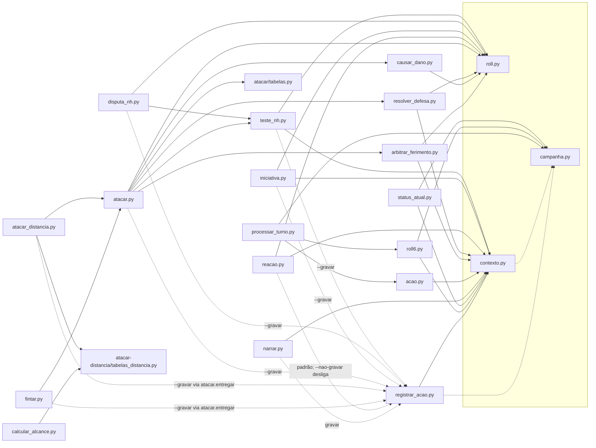
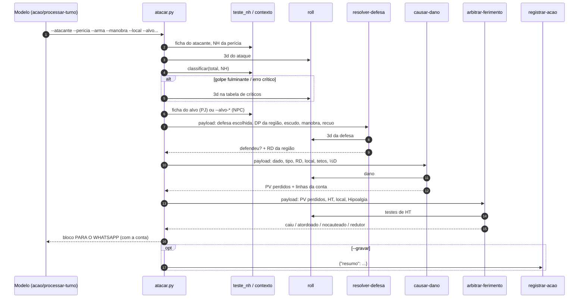
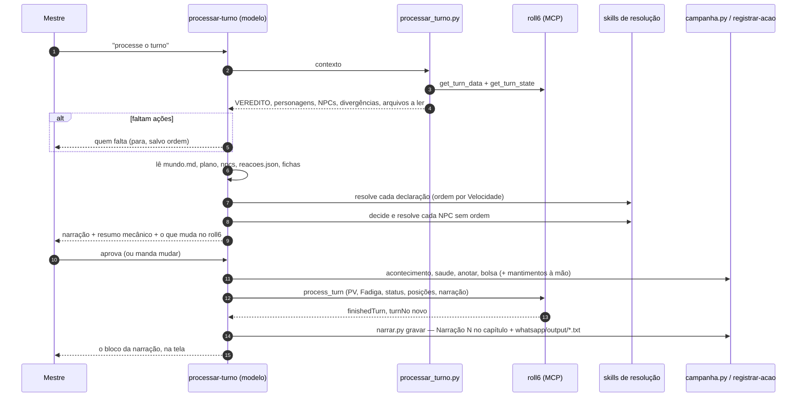
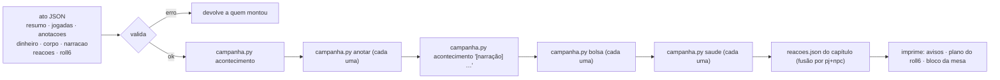
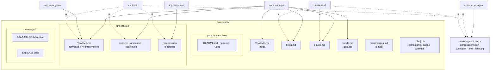

# As skills da mesa — mapa e funções

_Retrato de 03/10/2026, feito a partir do código de `.claude/skills/` (scripts e `SKILL.md`)
e do `CLAUDE.md`. Onde o texto de uma skill e o código discordam, este documento descreve
**o código** e a divergência vai para [`inconsistencias.md`](inconsistencias.md)._

São 25 skills. Elas se dividem em dois mundos que quase não se tocam:

- **A mesa** — 19 skills que arbitram, rolam, registram e espelham a campanha no roll6.
- **O material** — 5 skills que produzem coisa para a mesa usar: ficha, NPC, token,
  aventura solo.

---

## 1. As camadas

A ideia central do refactor de 01/10 é a frase do `CLAUDE.md`: **decisão fica nos
roteadores, cálculo na folha dona daquela grandeza, registro na registradora.**

| Camada | Regra que a define | Pode escrever? |
|---|---|---|
| Roteador | escolhe perícia, modificador, manobra, alvo do NPC; nunca cita número do livro | não (entrega o ato) |
| Resolvedor | monta a jogada e chama as folhas na ordem certa | não; com `--gravar`, entrega à `registrar-acao` |
| Folha | calcula **uma** grandeza e devolve número + linhas de conta | nunca |
| Base | `roll` sorteia, `contexto` lê | nunca |
| Escrita | `registrar-acao` recebe o ato em JSON e chama `campanha.py` | **sim — e só ela** depois do dado |
| Espelho | o roll6 recebe estado de jogo **só** pelo `process_turn` da `processar-turno` | só pela `processar-turno` (estado) ou por pedido explícito (material) |

---

## 2. O grafo real de chamadas

Este é o grafo **que os scripts executam**, tirado dos `import`/`subprocess` de cada
`scripts/*.py`. Linha cheia = import por caminho (`importlib.util.spec_from_file_location`);
tracejada = subprocesso.

O que o desenho mostra e o texto das skills não diz:

- **`atacar` não consome `contexto` diretamente**: lê ficha, perícia e `classificar()` pelos
  apelidos que o `teste_nh.py` reexporta (`tn.ler_ficha`, `tn.acha_pericia`...).
- **`fintar` e `atacar-distancia` importam o módulo inteiro do `atacar`** e usa as folhas por ele
  (`C.dv`, `C.cd`, `C.af`, `C.entregar`).
- **`calcular-alcance` (folha) depende de um arquivo de dentro do `atacar-distancia`**
  (`tabelas_distancia.py`, a tabela de escala).
- **`processar_turno.py` importa o `acao.py`** só para chegar às funções do `contexto` que o
  `acao` embrulha.
- O `causar-dano` **não** usa `contexto` (só `roll`); `resolver-defesa`, `arbitrar-ferimento`,
  `status-atual`, `roll6` e `registrar-acao` usam.

---

## 3. Fluxos

### 3.1 Uma troca de golpes (`atacar`)

O `atacar-distancia` é o mesmo desenho, com a etapa do NH efetivo trocada pelos cinco
passos de longo alcance (tamanho, velocidade/distância, Precisão, condições, Tiro Rápido) e
a defesa limitada a Esquiva/Bloqueio.

### 3.2 O turno do roll6 (`processar-turno`)

### 3.3 O ato resolvido (`registrar-acao`)

A `registrar-acao` **não fala com o roll6**: imprime o plano das chamadas MCP para quem
fecha o turno executar.

---

## 4. Onde cada coisa mora

| Arquivo | Quem escreve | Quem lê |
|---|---|---|
| `personagens/*/personagem.json` | `criar-personagem`, **só com pedido** | `contexto` (e todos através dela) |
| `campanha/saude.md`, `bolsa.md` | `campanha.py saude` / `bolsa` | `status-atual`, `processar_turno.py` |
| `campanha/mundo.md` | regerado por `anotar`, `bolsa`, `saude` | o Mestre antes de cada cena |
| `campanha/CONTEXTO.md` | `campanha.py elenco` (ao criar a campanha e ao criar, mudar ou remover um personagem) | **toda execução**: importado pelo `CLAUDE.md` e primeiro da lista da `contexto` e da `narrar` |
| `campanha/NN-*/README.md` | `campanha.py acontecimento`, `narrar.py gravar` | `narrar`, `contexto` |
| `campanha/NN-*/npcs.md` · `grupo.md` · `lugares.md` | `campanha.py anotar` | `contexto`, `narrar` |
| `campanha/NN-*/reacoes.json` | `registrar-acao` (vindo da `reacao`) | `contexto`, `processar_turno.py` |
| `campanha/mantimentos.md` | à mão (sem script) | ninguém por script |
| `campanha/roll6.json` | à mão | `roll6.py`, `processar_turno.py` |
| `campanha/whatsapp/output/*.txt` | `narrar.py gravar`, junto com a Narração N | o Mestre, para colar no grupo |

---

## 5. Cada skill

### Base

| Skill | Função | Entrada → saída | Escreve |
|---|---|---|---|
| **roll** | Único gerador de dado do repo. `1d+1`, `3d`, `2D-1`, `2Dx10`. Recusa d20/d10. | fórmula → dados e total; em Python, `d6(n)` e `rolar()` | nada |
| **contexto** | Dona de "quem age e como estão as coisas": resolve nome **parcial** de jogador ou personagem, lê ficha, NH de perícia, nível de vantagem, `classificar()` (decisivo/crítico), entrada da perícia no livro, estado da campanha, reações já roladas, lista de arquivos a ler. | `contexto --quem`, `quem`, `estado`, `classificar`, `reacoes` (todos com `--json`) | nada |

### Roteadores

| Skill | Função | Chama | Escreve |
|---|---|---|---|
| **acao** | Transforma a declaração livre de um jogador em regra: escolhe entre nada, `teste-nh`, `disputa-nh`, `atacar(-distancia)`, `reacao`, `iniciativa`, `roll`; decide a falha crítica antes de rolar; narra 3–8 linhas com a conta. `acao.py contexto` é um embrulho do `contexto`. | resolvedores, `calcular-alcance` | deveria só entregar o ato (ver inconsistências) |
| **processar-turno** | Fecha um turno jogado no roll6: confere quem declarou, resolve PJs e NPCs (com a régua "Decidir pelo NPC"), mostra ao Mestre, grava no repo e fecha com **um** `process_turn`. **Sempre** termina com a narração arquivada pelo `narrar.py gravar` e exibida na tela. Única skill que escreve estado de jogo no roll6. | `processar_turno.py contexto`, resolvedores, `campanha.py`, `narrar.py`, MCP | repo + roll6 |
| **narrar** | Escreve o texto de cena a partir do plano e do que já aconteceu; formato WhatsApp; numa cena com dado, a conta vai abaixo de cada parágrafo. `narrar.py gravar` arquiva como "Narração N" no README do capítulo, salva a cópia em `campanha/whatsapp/output/`, imprime o bloco na tela e entrega um resumo à `registrar-acao`. | `contexto`, `registrar-acao` | README do capítulo + `whatsapp/output/` |

### Resolvedores

| Skill | Função | Folhas usadas | `--gravar` |
|---|---|---|---|
| **teste-nh** | Teste de perícia/atributo/sentido/Vontade: acha NH (ou pré-definido), aplica `--mod` com motivo, rola, classifica; Sorte com `--sorte`. | `roll`, `contexto` | opt-in |
| **disputa-nh** | Disputa de Habilidades entre dois lados (ficha ou `--b-nh`), compara margens. | `teste_nh`, `roll` | opt-in |
| **atacar** | Troca de golpes inteira no Sistema Avançado: NH efetivo, críticos, defesa, dano, consequências; pescoço pela 4ª ed. | `resolver-defesa`, `causar-dano`, `arbitrar-ferimento`, `roll`, `teste_nh` | opt-in |
| **fintar** | Finta pela regra do MB (Avançar e Fintar): Disputa Rápida entre o NH do fintador e o do alvo (o maior entre escudo, arma e DX) e o redutor que sai da defesa ativa do alvo no **próximo ataque do fintador**. Recusa a finta que o livro não permite (`--impedimento`). Devolve o comando `--alvo-defesa-mod` para o `atacar` e o status tático do alvo. | `atacar` (ficha, NH, dado, entrega) | opt-in |
| **atacar-distancia** | Disparo/arremesso: cinco passos do NH à distância, ½D e Alcance Máximo, Esquiva/Bloqueio. | as mesmas, via `atacar` | opt-in |
| **reacao** | Teste de reação de cada NPC × cada PJ, tabela de reações; o resultado é **segredo** e vai para `reacoes.json`. | `roll`, `contexto` | **por padrão** (`--nao-gravar` desliga) |
| **iniciativa** | Surpresa e iniciativa pelo MB (Reflexos em Combate, líder, Tática). | `roll`, `contexto` | opt-in |

### Folhas de cálculo

| Folha | Grandeza | Recebe | Devolve |
|---|---|---|---|
| **calcular-alcance** | distância na grade odd-q do roll6 | duas posições (rótulo, `x,y`, nome de peça) | hexágonos, metros, linha da tabela de escala, lado e ângulo de visão |
| **validar-movimento** | o movimento legal de cada peça no turno | posições (início e fim), frente, manobra declarada, estado da ficha/roll6, `campanha/terreno.json` | Deslocamento de hoje, custo do livro, `veredito` (`ok`/`corrigir`), `posicao_valida`, Natação, avisos e alternativas quando a manobra é ambígua |
| **resolver-defesa** | a defesa do alvo | defesa escolhida, DP da região, escudo, manobra, recuo, situação | número, dado, sucesso, **RD da região** |
| **causar-dano** | a cascata de dano | dado, tipo, RD, local com tetos, ½D, fulminante | PV perdidos, desperdício, membro incapacitado, traqueia/decapitação |
| **arbitrar-ferimento** | o efeito do ferimento | PV perdidos, HT, local, Hipoalgia | redutor, queda, atordoamento, nocaute — o **status tático** |

### Escrita, espelho e leitura

| Skill | Função |
|---|---|
| **registrar-acao** | Recebe o ato em JSON, valida, confere os dois lados (dinheiro, item, dano), chama `campanha.py` na ordem log → anotações → narração → bolsa → saúde, funde `reacoes.json`, imprime o bloco da mesa e o **plano** das chamadas do roll6. Não fala com o MCP. |
| **campanha** | Dona do formato de `campanha/`: plano × histórico, capítulos, capítulo atual, acontecimentos, anotações (`npcs`/`grupo`/`lugares` → `mundo.md`), `bolsa`, `saude`, índices, encerramento. |
| **roll6** | Espelho na mesa virtual: `campanha/roll6.json`, `roll6.py` (`estado`, `chamar`, `subir-imagem`, `subir-documento`, `alinhar`, `mapa`, `saude`) e a tabela do que cada skill empurra. |
| **status-atual** | Bloco do WhatsApp com dinheiro, PV, Fadiga e estados de cada PJ, lendo `bolsa.md`, `saude.md` e as fichas. Só lê. |
| **pensar-acao** | Para o jogador: lê a cena no roll6 (narrações, turno, chat) e a ficha via `contexto`, e sugere 3 ações amarradas a desvantagens, peculiaridades e perícias, com fala, teste provável e risco. Não lê o plano nem as reações, não rola e não declara. Só lê. |

### Material (fora do fluxo de jogo)

| Skill | Função | roll6 |
|---|---|---|
| **criar-personagem** | Ficha de PJ do zero ou edição: custos, derivados, `personagem.json/.md`, `ficha.jpg`, prompt de retrato. Conjurador ganha grimório de mágicas; lutador com manobras ganha grimório de manobras (resumo de cada uma, NH continua em `pericias[]`). | `create_character` / `update_character` por pedido |
| **criar-npc** | NPC em bloco compacto estilo Farvaro, montado pela `criar-personagem`. | `create_npc` → `add_npc_to_campaign` → `place_npc_on_map` |
| **token-hex-gurps** | Miniatura top-down 1:1 de um personagem ou NPC. | `create_token` |
| **token-organizator** | Tria imagens soltas em tokens: fundo transparente, girar para o sul, renomear, catalogar. | `create_token` |
| **aventura-solo-gurps** | Gamebook de parágrafos numerados, sem Mestre. | — |

---

## 6. Regras que atravessam todas

1. **Dado só pela `roll`.** Relate o que o script imprimiu; nunca role de novo por ter saído ruim.
2. **Ficha só muda com pedido explícito.** O que a mesa produz vai para `bolsa`, `saude`,
   `mantimentos` e anotações.
3. **Reação é segredo.** Fica em `reacoes.json`; nunca vai ao roll6, ao WhatsApp nem à narração.
4. **A narração mostra a conta.** Cada parágrafo de jogada leva as linhas `> ` do script logo abaixo.
5. **Um bloco por rodada em combate**; fora de combate, um bloco por ação.
6. **Estado de jogo no roll6, só pelo `process_turn`**; material, só por pedido.
7. **Aprovação do Mestre antes de gravar e fechar o turno**, salvo aviso dele.
8. **Mestre discordou, a regra cai**, e a decisão vira errata no registro.
9. **Nenhuma skill aninhada em outra**: os imports sobem por `parents[2]`.
