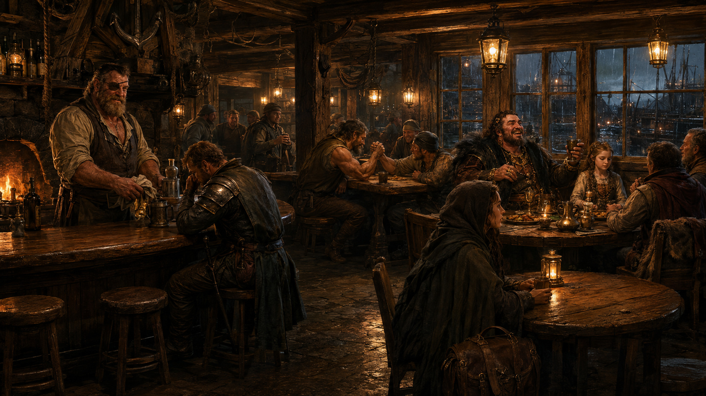
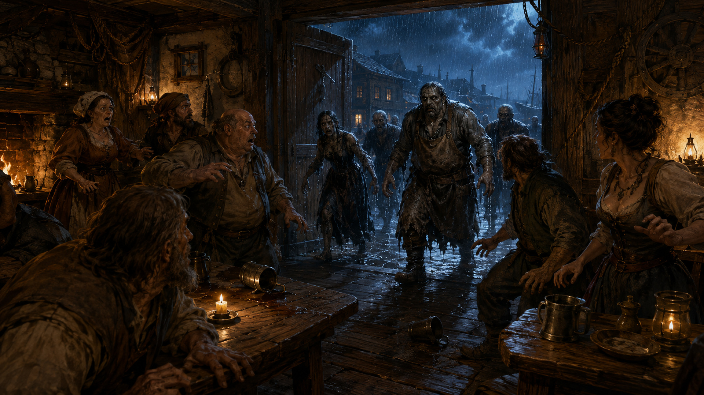

# 1. Encontro na Taberna

**Mapa:** `cenarios/taberna3.json`
**Local:** Taberna da estrada, Wallace (Caithness)
**Imagem inicial:** `inicio.jpg`

A campanha abre no meio de uma noite comum: os personagens estão bebendo n**A Âncora
Quebrada**, taberna da estrada de Wallace. **Não anuncie que é uma campanha de
mortos-vivos.** Esta primeira meia hora de mesa é para os jogadores se apresentarem, se
divertirem e — sem saber — conhecerem gente que vai morrer.

> **Por que uma âncora numa terra sem mar.** Wallace fica na fronteira oeste de Caithness,
> na orla do Grande Deserto (*Fantasy*, pág. 72): fazendeiros, pastores, lã, poeira e
> nenhuma água navegável a semanas de viagem. A âncora de ferro pendurada sobre a porta é
> justamente a piada da casa — dizem que o primeiro dono foi marinheiro em Araterre antes
> de vir morrer de sede aqui, e trouxe a âncora para não esquecer o que tinha largado.
> Todo forasteiro pergunta, e todo freguês tem uma versão diferente da história.
> **Não há porto, cais nem barco em Wallace.** O que a cidade tem é o mercado, os currais,
> a estrada das caravanas e a água de que os feudos vizinhos têm inveja.

Então a porta se abre.

## Antes de a porta abrir

**Dê à cena uns vinte ou trinta minutos reais.** Vale o investimento: tudo o que vem
depois é fuga e luta, e a campanha inteira funciona melhor se a mesa tiver gostado da
taberna antes de vê-la acabar.

As situações abaixo são **independentes** — rode na ordem que a mesa puxar, use três ou
use todas. Nenhuma precisa ser resolvida.

### O relógio da noite

Por baixo das conversas, deixe cair **um presságio a cada cinco ou dez minutos**, sem
comentar nenhum. Ninguém na taberna liga para eles até o terceiro.

| # | O presságio | Como jogar |
|---|---|---|
| 1 | **Os cães.** Todos os cães dos currais começaram a uivar ao mesmo tempo, e não pararam. | Mencione de passagem. Um freguês reclama do barulho |
| 2 | **O sino.** O sino da capela toca fora de hora — nove badaladas, quando não é hora de nada. | Hoel para de servir por um segundo e escuta. Depois continua |
| 3 | **O silêncio.** Os cães param. **Todos, de uma vez.** | Agora sim: a taberna inteira percebe. Ninguém fala por três segundos |
| 4 | **Os gritos**, longe, na direção do mercado. E então a porta. | É o gancho para a cena seguinte |

Quem quiser investigar um presságio pode: sair até a rua, subir ao quarto de cima, olhar
pela janela. **Deixe.** Quem estiver na rua quando o quarto presságio chegar começa o
combate do lado de fora, no hexágono que escolher — e vê a rua antes dos outros.

### Situação 1 — O guarda que bebe rápido demais (balcão, B5-B7)

**Osric de Bannock**, guarda do castelo, fora de serviço e no terceiro caneco em menos de
uma hora. Bebe olhando o copo, não fala com ninguém.

Ele é a fonte da única informação verdadeira da noite. E é **o mesmo guarda que os
personagens vão reencontrar na muralha no capítulo 3** — dê-lhe cara e voz agora.

| O que quer saber | Perícia | Sucesso | Falha |
|---|---|---|---|
| Por que está assim | Trato Social, ou pagar a bebida (+2) | Conta o de baixo | "Não é da sua conta" |
| Se está mentindo | Detectar Mentiras | Está sóbrio o bastante para saber o que diz | — |

O que ele conta, se conquistado: há **três dias** uma patrulha de quatro homens saiu para
as fazendas a oeste e **voltaram só três** — e os três não sabem dizer o que aconteceu com
o quarto. Um deles jura que o companheiro *acenou de volta* da linha das árvores, depois
de já estar caído. O capitão mandou calar a boca.

*(O Mestre sabe: era Vurkash, testando. O quarto homem foi o primeiro.)*

### Situação 2 — A mesa boa (mesa comprida no tapete, I6-L8)

**Giles Mão-de-Prata**, mercador de lã, comprou a mesa boa da casa para a noite e está
comemorando alto o noivado da filha **Bronwyn** com um rapaz de Carrick que ela nunca viu.
Bronwyn não está comemorando.

- Giles é **generoso quando bebe**: reação **+2** para qualquer um que brinde ao noivado, e
  ele paga a rodada. Reação **-2** para quem falar com a filha.
- Bronwyn quer que alguém a leve para longe de Wallace. **Ela oferece o colar da mãe.**
  Reação **+1** para quem for gentil, **+3** para quem for gentil *e* não aceitar o colar.

**Isto tem consequência no capítulo 2.** Se os personagens se importarem com a família,
vão querer buscá-los na fuga — e cada civil salvo custa 5 minutos e -2 na Furtividade, mas
vira aliado no capítulo 14. A escolha fica mais difícil, e portanto melhor, se eles tiverem
brindado com Giles duas horas antes.

### Situação 3 — O braço-de-ferro (mesa redonda, E7)

**Donnwulf**, pedreiro, ST 14, não perde há dois meses e faz questão de dizer isso. Há
**$40** em moedas na mesa e um círculo de fregueses gritando.

Disputa regular de **ST**. Quem topar e ganhar leva os $40 e a simpatia da casa
(**+1 de reação com qualquer freguês** pelo resto da noite). Quem perder paga a rodada.

Um personagem com **Trapaça** ou **Prestidigitação** pode ganhar de Donnwulf com um teste
contra a Percepção dele (10) — e se for pego, a briga começa **antes** dos mortos-vivos, o
que é ótimo.

**Donnwulf está entre os que vão se levantar.** Se ele morrer na rua no capítulo 2, use a
ficha de Morto-Vivo 1 e **diga o nome dele**. O braço que venceu a aposta vem na frente.

### Situação 4 — O menino e os cavalos (porta, I11)

**Wat**, doze anos, cuida do estábulo dos fundos. Entra correndo entre o segundo e o
terceiro presságio, branco, e procura Hoel: **os cavalos estão tentando arrebentar as
baias.** Todos. Ao mesmo tempo.

Hoel manda ele voltar e "acalmar os bichos". Se um personagem se oferecer para ir junto,
**deixe** — dá para ver a rua vazia, ouvir os cães, e voltar a tempo. E planta o estábulo,
que é a rota alternativa do capítulo 2.

Wat sabe onde ficam **os cavalos e a saída dos fundos**. Vale mais que qualquer arma na
próxima meia hora.

### Situação 5 — O contrato para amanhã (mesa do canto, N7)

**Teressy**, sozinha, de capa boa e botas de viagem, com uma bolsa que não larga. Está
procurando **três braços para uma escolta até Carrick**, saindo ao amanhecer. Paga **$150
por cabeça**, um terço adiantado, e não diz o que está escoltando.

- **Manha** ou **Trato Social**: a bolsa é pesada demais para roupa.
- **Detectar Mentiras**: ela não está mentindo — está com medo, o que é diferente.

Ela quer sair de Wallace **amanhã**, e não vai conseguir. Se sobreviver ao capítulo 2, o
que carrega é problema do Mestre — e um belo gancho solto. Se o Mestre não quiser esse
peso, ela morre na rua e a bolsa fica onde caiu, para quem quiser pegar.

### O que os personagens estão fazendo ali

Se algum jogador não souber por que seu personagem está na taberna, ofereça: esperando
Teressy (situação 5), gastando o último pagamento, hospedado no quarto de cima, ou
simplesmente sem outro lugar quente para ficar. **Não force uma missão** — a campanha
começa quando a porta abre, não antes.

## O que acontece

**Um Morto-Vivo 1 por personagem de jogador** entra bruscamente pela porta. Não falam,
não recuam e não se defendem: cada um avança contra um personagem.

Lá fora já se ouvem gritos. Ninguém na taberna sabe ainda o que está acontecendo.

O mapa é 15 × 11 m, grid de 1 hexágono por metro. Entram pela **porta sul** (I11–K11) e
se separam: o mais próximo de cada personagem é o alvo daquele morto-vivo. Se dois
estiverem no mesmo hexágono, o segundo morto-vivo pega o seguinte mais perto.

**Quem são importa.** Não use desconhecidos para todos: a mesa precisa reconhecer pelo
menos um. O melhor candidato continua sendo **Wat**, o menino do estábulo, se ele saiu na
situação 4 — a mesa entende tudo de uma vez. Os demais: um apostador do círculo do
braço-de-ferro, um tropeiro, alguém que veio da rua (os gritos do mercado) — complete
até um por jogador. Não use Hoel, Giles, Bronwyn, Osric nem Teressy nesta primeira onda —
eles ainda têm o que fazer.

Se preferir poupar o menino, ele volta vivo no capítulo 2, e aí é ele quem leva os
personagens ao estábulo. Substitua-o por outro freguês nomeado na hora.

## Testes

### A surpresa

É um caso de **Surpresa Total** pelo MB, cap. 14 ("Ataques de Surpresa e Iniciativa"):
ninguém na taberna esperava problema, e o que entra pela porta não é um problema que
alguém já tenha visto.

**Não se rola iniciativa aqui.** Iniciativa, no GURPS, é rolada **por lado e só na
Surpresa Parcial**, quando os dois grupos esperavam encrenca — não é o caso.

| Passo | Regra | Detalhe |
|---|---|---|
| 1. Paralisia | O Mestre rola **1d**: é quantos **segundos** a taberna inteira fica paralisada | Quem tem **Reflexos em Combate nunca fica paralisado** e age desde o primeiro turno |
| 2. Recuperação | Passada a paralisia, **teste de IQ no início de cada turno** | **+6** com Reflexos em Combate |
| 3. Efeito do sucesso | Age normalmente **pelo resto do combate** — não se testa de novo | — |
| 4. Efeito da falha | Continua **mentalmente atordoado**: sem defesa ativa, sem ação | Repete o teste no turno seguinte |

**Personagem atordoado não tem defesa ativa.** É essa a razão de a cena ser perigosa:
há um morto-vivo por jogador, e quem ainda não passou no IQ não se defende.

O livro é duro aqui e não dá bônus acumulativo na Surpresa Total — o `+1 por turno` existe
só na Surpresa Parcial. Se a mesa travar (IQ baixo, azar), **o Mestre pode conceder** o
mesmo acúmulo: é razoável e evita que alguém perca a cena inteira olhando.

### Ordem dos turnos

Coisa diferente da surpresa, e vale para todo o combate da campanha. Use o **Modo
Realista** (MB, cap. 13): ordem fixa por **maior Deslocamento**, empate pela **Velocidade
Básica**, empate ainda nos dados. Anote uma vez no campo *Sequência* da ficha, **na mesa**,
com quem de fato sentou — o plano não presume grupo.

Os Mortos-Vivos 1 têm Deslocamento 5 e Vel. Básica 5,25. Empatados entre si: jogue 1d
para desempatar, ou trate-os como agindo no mesmo instante.

A paralisia da Surpresa Total ignora essa ordem — os mortos-vivos agem e os personagens
não, até passarem no teste de IQ. Quem tiver o menor Deslocamento (armadura pesada é o
caso típico) é o mais exposto no primeiro turno.

## NPCs

**Morto-Vivo 1 (Cidadão Comum)** — ficha em [`npcs.md`](npcs.md). **Um por personagem de
jogador.**

A cena não é para massacrar a mesa — ainda são cidadãos comuns, ST 11, sem armadura. É
para estabelecer que os mortos se levantam **e que cada um tem o seu**. **Não param
quando feridos** — Hipoalgia, que ignora o redutor por choque de ferimento.

Deixe um personagem acertar um bom golpe e o morto-vivo dele continuar vindo. É esse o
momento em que a mesa entende o que está acontecendo.

## Se os jogadores fizerem outra coisa

- **Fugir pela janela ou pelos fundos** — deixe. O capítulo 2 começa igual, com eles na
  rua em vez de na porta da taberna.
- **Agarrar sem matar, amarrar** — funciona; um Morto-Vivo 1 tem ST 11 e nenhuma perícia
  de luta. Amarrados no porão são um ótimo problema para depois e o jeito mais elegante
  de os personagens descobrirem sozinhos que eles não comem, não dormem e não cansam.
- **Perguntar ao taberneiro o que está havendo** — ele não sabe. Ninguém sabe. Isso *é* a
  informação: a cidade está caindo agora, sem aviso.
- **Barricar a taberna** — deixe funcionar por dois minutos e então faça crescer o número
  de gemidos lá fora. A taberna não é defensável; o castelo é.
