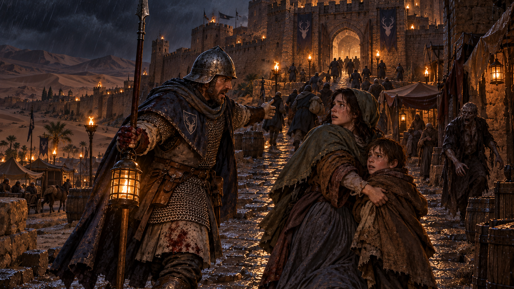
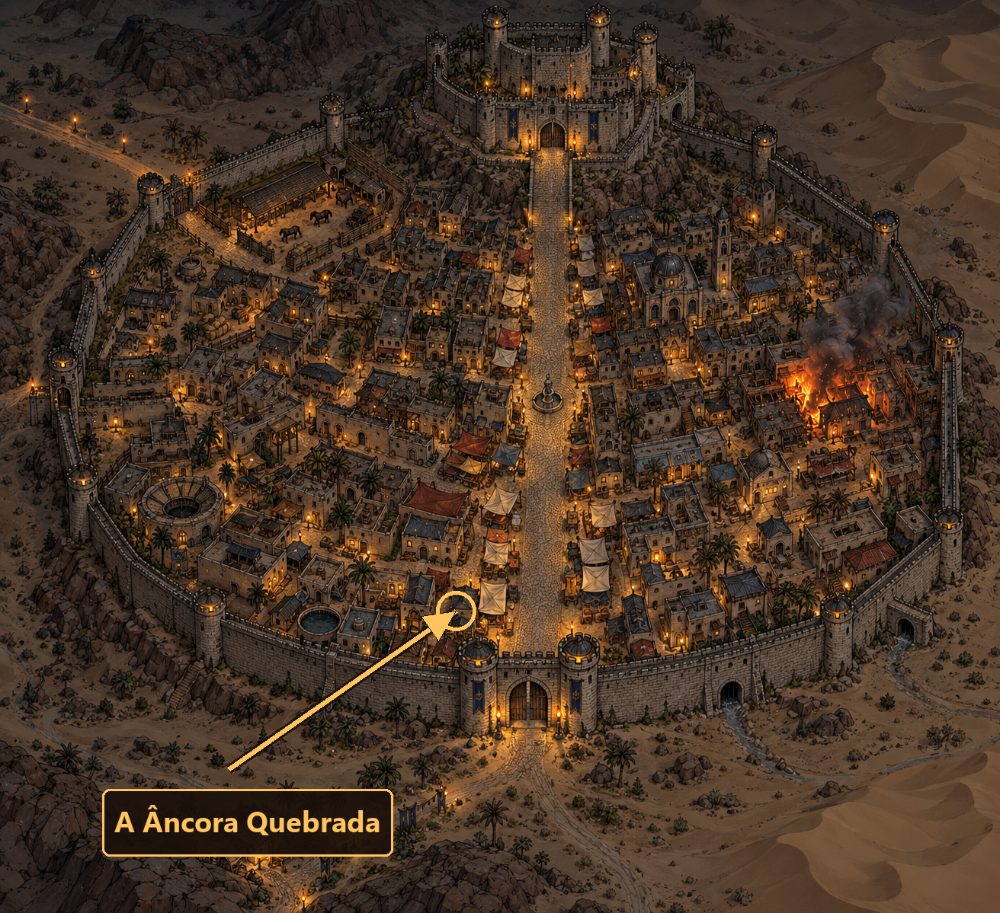

# 2. A Fuga para o Castelo

**Local:** Ruas entre a Âncora Quebrada e o castelo de Wallace (Caithness)
**Hora:** Noite de chuva, logo após a primeira onda de mortos-vivos
**Imagem inicial:** `inicio.png`

> A porta da taberna bate atrás de vocês. Wallace, que há uma hora era só chuva, cerveja e cães inquietos, agora grita em cada rua. No alto da ladeira, o portão do castelo ainda está aberto; os soldados já puxam as correntes. Chegar lá não basta: é preciso chegar antes que a cidade seja deixada do lado de fora.

## A primeira coisa que veem: o guarda do cruzamento

**Antes de qualquer escolha de rota**, um guarda de Wallace está no cruzamento em frente à
taberna, sozinho, mandando as pessoas subirem. É um homem de meia-idade com a celada torta
e a espada curta ainda embainhada, e ele repete a mesma frase para cada rosto que aparece:
**"Para o castelo! Pela avenida, sem parar, e não abram porta nenhuma!"**

Ele existe por três razões, nesta ordem:

1. **Mandar o grupo pelo pior caminho da cidade, de boa-fé.** A avenida é a ordem que veio
   do castelo, e ele a repete porque é o que um guarda faz. **Ele está errado** — veja *A
   avenida é uma armadilha*, adiante — e não tem como saber. O conselho é sincero, a
   autoridade é real, e seguir os dois é o erro mais caro deste capítulo.
2. **Mostrar que a cidade ainda funciona** — e por pouco tempo. Há ordem, há guarda, há
   um plano. O plano é ruim. No capítulo 3 esse mesmo plano estará fechando o portão na
   cara de gente viva.
3. **Ser a primeira testemunha depois da taberna.** O que o grupo fizer aqui é o que a
   guarda vai saber sobre ele quando chegar ao portão.

**Não avise a mesa.** O jogador que desconfiar de uma ordem oficial numa noite dessas
merece o que vai economizar; quem obedecer não está sendo punido por confiar, está
descobrindo, com todo mundo junto, para onde uma cidade inteira foi mandada.

### O que ele sabe, e o que não sabe

| Sabe | Não sabe |
|---|---|
| Que o portão do castelo está aberto e vai fechar | Quanto tempo falta — ele chuta "logo" |
| Que a ordem veio do castelo e a avenida é a rota | **Que a avenida virou a pior rua da cidade** — ele está de costas para ela, mandando gente entrar |
| Que há gritos no mercado e fogo a leste | Que os mortos se levantam; para ele são "doentes", "amotinados" ou "os do deserto" |
| Que não pode largar o posto até passar a última pessoa | Que quase ninguém que ele mandou subir chegou ao castelo |
| Que meia cidade já passou por ali | Que ele não vai conseguir cumprir o que prometeu a si mesmo |

**Ele não é um obstáculo.** Não revista, não prende e não pede nome — está apavorado e com
pressa. Só olha os rostos, porque foi mandado olhar.

### Testes

| O que o personagem quer | Perícia | Sucesso | Falha | Falha crítica |
|---|---|---|---|---|
| Só obedecer e seguir | — | Nenhum teste, nenhuma vantagem. Sobem a avenida com todo mundo, e a avenida cobra | — | — |
| **Olhar a avenida antes de entrar nela** | **Observação** | **Vê o que há lá em cima** e pode escolher outra coisa — é a pista principal desta cena. Veja *A avenida é uma armadilha* | Vê só uma rua cheia de gente correndo para o mesmo lado, que é o que ela parece ser | Toma a multidão por segurança: **-2 no próximo teste** para mudar de ideia sobre a rota |
| Arrancar mais informação | Trato Social, Liderança ou teste de reação | Diz onde há fogo, quais ruas já não respondem e **que a patrulha que ele mandou pela avenida não voltou** — ele conta isso sem entender o que está dizendo | Repete a frase e manda seguir; custa 1 segmento | Grita com o grupo, e o grito atrai 1 Morto-Vivo 1 |
| Perceber o estado dele | Observação ou Empatia | Vê que ele está sozinho, que a mão treme e que ninguém vai render seu posto — ele pode ser convencido a vir junto | Parece só um guarda ríspido | — |
| Avisá-lo de que a avenida é armadilha | Liderança, Diplomacia ou Trato Social, **-2** | Ele hesita, olha para cima pela primeira vez na noite e **passa a mandar as pessoas pelos becos**. Muda o capítulo 3: chegam mais vivos ao portão | Ordem é ordem; continua mandando pela avenida | Acha que estão tentando enganá-lo para saquear as casas; **-3 de reação** e ele repete o rosto de quem falou, no portão |
| Convencê-lo a abandonar o posto | Liderança, Diplomacia ou Trato Social, **-3** | Ele vem junto: uma espada a mais e um rosto conhecido no portão do capítulo 3 | Fica, e morre ali | Fica, e conta a quem chegar que aquele grupo tentou tirá-lo do dever |
| Perguntar por alguém da cidade | Trato Social | Sabe onde mora quase todo mundo; aponta a rua | Não conhece aquele nome | — |

### Se alguém do grupo for procurado pela guarda

Este guarda **não** foi avisado — a denúncia levada ao castelo ainda não desceu até um
homem de rua no meio de uma cidade caindo. Mas ele **olha os rostos**, e é isso que
importa: se o grupo se identificar, ameaçar, empurrar ou ferir este homem, ele é
**exatamente a testemunha que reaparece no portão do capítulo 3**, e o que ele disser lá
vale mais que qualquer argumento. Um grupo que o trate bem — ou que o traga junto — chega
ao portão com um guarda de Wallace falando a seu favor.

**Ferir ou matar o guarda:** trate como consequência social, nunca como encontro sem dono.
Há civis correndo pela avenida e todos veem. No capítulo 3, isso fecha o portão.

### Se o grupo ignorar e seguir por outra rota

Perfeitamente legítimo, e o guarda nem repara — já está gritando para os próximos. **Este é
o desfecho bom desta cena**, ainda que ninguém à mesa saiba disso: desobedecer aqui poupa
ao grupo as três quadras da avenida. Não insista, não recompense em voz alta e não
dificulte: ele grita mais uma vez às costas do grupo e some da cena.

O único preço de ignorá-lo é a informação que ele daria de graça — e o fato de que, mais
tarde, ele não vai lembrar de nenhum rosto que passou correndo sem falar com ele.

## O mapa da cidade

*Wallace vista de cima, na noite em que cai. Use para mostrar à mesa por onde se pode
correr — as cinco rotas da tabela abaixo estão todas aí.*

**A seta marca a Âncora Quebrada**, do lado oeste da avenida, **logo dentro do portão
sul** — a primeira casa com fogo aceso para quem entra em Wallace pela estrada, e por
isso a taberna dos que chegam com as caravanas. É de onde o grupo sai, e explica a
geografia da fuga: o castelo está no **extremo oposto** da cidade, lá em cima, e a
avenida do mercado atravessa Wallace inteira entre um ponto e outro. Ninguém chega ao
portão do castelo sem cruzar a cidade toda.

O **quarteirão em chamas** que se vê à direita, a leste, é a rua dos cordoeiros.

| No mapa | É a rota |
|---|---|
| A avenida larga que sobe do portão sul até a rampa do castelo | **Avenida do mercado** — a mais curta no mapa, a pior na prática, e a única que a guarda recomenda |
| O emaranhado de becos entre as casas, dos dois lados da avenida | **Becos dos currais** |
| Os telhados encostados uns nos outros, na metade baixa | **Telhados e passarelas** |
| O curral com cavalos, encostado na muralha a noroeste, com a estrada saindo pelo portão pequeno | **Estábulo dos fundos** — e a saída para a estrada oeste |
| O curso d'água que sai por baixo da muralha, a leste | **Canal de drenagem** — e ele *vem de dentro do castelo* |
| O quarteirão em chamas, a leste | **Fogo na rua dos cordoeiros** |

O portão do castelo é o do alto, no fim da rampa: é para lá que o relógio dos 12
segmentos está correndo.

## O que acontece

O castelo é o abrigo mais visível, não o único destino possível. Os personagens podem correr para ele, salvar alguém, buscar cavalos, procurar família, levantar uma barricada ou se esconder até entenderem a catástrofe. Não os reconduza à rota "certa"; deixe que o relógio e as consequências façam o trabalho.

### O relógio do portão

Comece com **12 segmentos**. Cada segmento representa cerca de cinco minutos, e o portão fecha ao chegar a zero. Marque o relógio à vista da mesa e anuncie os marcos: 9 (os sinos param), 6 (as correntes começam a ranger), 3 (só restam soldados e feridos do lado de fora), 0 (o portão fecha).

| Custo de tempo | Ação |
|---|---|
| 1 segmento | atravessar uma quadra por rota conhecida; uma tentativa breve de ajudar ou procurar |
| 2 segmentos | combate curto, arrombar obstáculo, conduzir civis, procurar uma casa específica |
| 3 segmentos | desviar por telhados, estábulo, canal ou incêndio; combate prolongado |

Ao acabar o relógio, siga para o capítulo 3 se alguém alcançou o portão. Quem ficou fora não morreu automaticamente: os soldados jogam cordas depois que o portão fecha, mas começam o capítulo 3 isolados e sob pressão. Se ninguém chegou, leve o grupo para o capítulo 6: a fuga para o deserto começou cedo, sem William e sem a proteção do castelo.

## Escolhendo uma rota

Os personagens podem inventar outra rota. Cada opção abaixo existe para dar um preço claro às boas ideias, não para limitar a cidade.

| Rota | Tempo | Teste | Consequência |
|---|---:|---|---|
| **Avenida do mercado** — *a pior* | **4+** | Nenhum para ser achado. Para atravessar cada quadra: Corrida, Furtividade **-3** (multidão) ou abrir caminho no braço | **Encontro obrigatório por quadra, três quadras.** É a rota mais curta no mapa e a mais lenta na prática: a cidade inteira foi mandada para cá. Veja abaixo |
| Becos dos currais | 3 | Furtividade, individual | Sucesso: passa. Uma falha: 1 Morto-Vivo 1 ou 2 encontra o grupo. Duas+: 1 Morto-Vivo 3 chega pela retaguarda |
| Telhados e passarelas | 3 | Escalada ou Acrobacia | Sucesso: evita os mortos no chão. Falha: perde 1 segmento e fica separado; falha crítica: queda de 1d-2 contusão e barulho atrai 1 Morto-Vivo 2 |
| Estábulo dos fundos | 3 | Cavalgar, Trato com Animais ou IQ para acalmar as montarias | Há cavalos e uma saída para a estrada oeste. Sucesso permite escolher castelo ou deserto; falha assusta os animais e custa 1 segmento extra |
| **Canal de drenagem** — *a porta dos fundos do castelo* | 3 | Sobrevivência (Urbana), Conhecimento de Área ou IQ-5. Quem for guiado pelo rapaz do mercado dispensa o teste | **Entra no castelo sem passar pelo portão, e sem encontro nenhum** — é a única rota que não depende do relógio. O preço é o corpo: não passa com Carga acima de leve, nem com escudo grande. Falha leva à grade enferrujada e custa 2 segmentos para abrir. Veja abaixo |

Uma personagem com **Conhecimento de Área (Wallace)**, **Manha** ou que tenha falado com Wat ganha +2 para escolher uma rota e sabe da saída dos fundos. Um personagem que observa a rua antes de avançar pode testar **Observação**; sucesso revela o encontro imediato ou reduz em 1 o resultado de um encontro aleatório.

### O canal: a porta dos fundos

**Wallace tem mais água do que qualquer feudo da fronteira** — é isso que a distingue de
Ferrier e Blythe, onde a seca é a luta de todo dia, e é por isso que o castelo foi
construído onde foi. **A água do feudo é controlada lá de cima.** O que desce pelo canal de
drenagem e sai fervendo por baixo da muralha a leste **vem da cisterna do castelo**, e
quem sobe por ele chega ao mesmo lugar de onde ela vem.

Poucos sabem disso, e ninguém que sabe tem motivo para contar: é a fraqueza da casa.

**Esta é a única rota que não depende do relógio.** O portão fecha; o canal, não. Se o
grupo tem o canal, tem como entrar no castelo depois de a corrente cair — o que muda o
peso de tudo o que fizerem até lá. Por isso ele custa caro de três maneiras, e as três
importam mais que o tempo:

1. **Tudo passa pela boca — o problema é a água.** O duto tem a largura de um homem
   deitado, e escudo grande, montante e mochila entram sem drama: é engatinhar, não
   espremer. **O preço é cobrado no trecho alagado**, e é cobrado pela regra de Natação
   (MB pág. 91), que desconta **o dobro do nível de Carga** do teste. Quem levar tudo nada
   com -4 ou pior; quem largar na margem nada melhor e atravessa o resto da noite sem o
   que largou. **A decisão é do jogador, e é boa justamente porque não é obrigatória** — o
   Mestre põe os dois números na mesa e deixa escolher. Cota de malha passa molhada e
   pesando o dobro: peça um teste de HT ao fim da subida.
2. **Sai dentro da cisterna, e ninguém é esperado lá.** O grupo emerge no poço do pátio de
   serviço, encharcado, de dentro da água que a guarnição bebe, numa noite em que a cidade
   está sendo tomada por mortos. **A primeira reação de quem estiver no pátio é tratá-los
   como invasores** — não como refugiados. Role a reação com redutor de **-3**, e aplique
   todos os modificadores que o grupo carregar: quem for procurado pela guarda desta cidade
   sai muito pior daqui.
3. **A grade.** Na falha do teste, o duto termina numa grade de ferro enferrujada, chumbada
   na pedra. Abrir custa **2 segmentos** e um teste de ST combinada, ou Arrombamento; o
   barulho é alto e a água amplifica.

**O que o canal não resolve:** ele entrega o castelo, não a boa vontade de quem está
dentro. O grupo chega sem ter sido visto ajudando ninguém na cidade, por um caminho que
só um saqueador conhecia, e cai no colo da mesma guarnição do capítulo 3.

### A avenida é uma armadilha

**É a única rota que fica pior por ser a recomendada**, e a razão é simples de explicar à
mesa depois, quando ela entender: *a ordem do castelo mandou a cidade inteira para a mesma
rua*. Onde há mais gente viva correndo, há mais gente caindo — e **quem cai na multidão se
levanta dentro da multidão**, a um braço de distância de quem estava correndo ao lado. A
avenida não está cheia de mortos que vieram de fora; ela está **fabricando os próprios**,
quadra por quadra, mais depressa do que as pessoas conseguem subir.

Some a isso o que uma multidão em pânico faz por conta própria: gente derrubada e pisada,
carroças atravessadas, quem parou para procurar um filho, e ninguém conseguindo correr mais
rápido que o mais lento à sua frente.

**Como funciona, em regra:**

| | |
|---|---|
| **Extensão** | Três quadras da taberna até a rampa do castelo, e um **encontro obrigatório em cada uma** — não role para saber *se* há: role para saber *qual* |
| **Custo** | **4 segmentos no mínimo**, e sobe com cada luta que passar de três turnos. É a rota mais cara do capítulo |
| **A multidão** | **-3 em Furtividade e em qualquer manobra de deslocamento**. Ninguém corre à vontade; o Deslocamento efetivo de todos vira **2**, ou o do mais lento do grupo, o que for menor |
| **Combate ali dentro** | Cada golpe de área, cada flecha errada e cada empurrão acerta um civil. **Não há recuo** — o hexágono atrás está ocupado por gente |
| **A cada quadra** | 1 Morto-Vivo 1 **por personagem**, e mais **um novo a cada rodada** que a luta se arrastar: alguém que acabou de cair ali perto se levanta |
| **Separar-se** | Quem falhar num teste de deslocamento é **arrastado pela corrente de gente** por uma quadra e chega sozinho ao próximo cruzamento |

**Os três encontros da avenida**, em ordem, se o grupo insistir:

1. **A primeira quadra** parece dar certo — é gente correndo e nada mais. Um Morto-Vivo 1
   por personagem, no meio do fluxo, e a mesa ainda acha que foi só azar.
2. **A carroça tombada** (encontro descrito adiante) bloqueia o cruzamento do meio. Aqui a
   multidão engarrafa: a rua para, e é *isto* que mata. Enquanto estiverem parados, um
   morto novo por rodada.
3. **O engarrafamento da rampa**, embaixo do castelo, onde a avenida estreita. Centenas de
   pessoas empurrando para um portão que já está fechando. Um Morto-Vivo 2 no meio delas e
   nenhum espaço para lutar — quem sacar arma grande aqui acerta gente.

**A saída, e ela existe sempre:** de qualquer quadra da avenida dá para entrar num beco
lateral, com **Manha**, **Conhecimento de Área** ou **IQ-4**. Custa 1 segmento e joga o
grupo na rota dos becos dos currais, a partir daquele ponto. **Ofereça essa porta toda vez
que a mesa parecer presa** — o capítulo é sobre escolher, não sobre punir quem escolheu
errado uma vez.

**Como a mesa pode descobrir antes:** Observação no cruzamento (na tabela do guarda);
perguntar ao guarda e ouvir que *a patrulha que subiu não voltou*; qualquer personagem que
olhe para a rampa e conte quanta gente está entrando contra quanta está passando pelo
portão; ou o saqueador apavorado, que viu e conta — exagerando, mas conta.

## Combate rápido — regra só deste capítulo

Este capítulo tem muitas lutas pequenas e um relógio correndo. Resolver cada morto pelo
Sistema Avançado, com mapa e ponto de impacto, mata o ritmo da fuga. **Enquanto durar o
capítulo 2, todo combate de rua é resolvido numa jogada por personagem, por inimigo.**

O modelo é o *Combates mais Rápidos* do MB (cap. 14), que já manda tratar ataque e defesa
como uma Disputa Rápida — aqui a disputa resolve a troca inteira, não só um golpe.

### Como se joga

1. **O personagem escolhe a perícia** com que vai enfrentar aquele inimigo. Vale qualquer
   uma que ele saiba justificar: uma perícia de combate, mas também **Corrida** para passar
   sem lutar, **Furtividade** para contornar, **Briga** desarmado, **Escudo** para
   atropelar. A escolha é do jogador, e o Mestre só recusa o absurdo.
2. **Os dois rolam 3d.** O personagem contra o NH escolhido; o inimigo contra o NH dele.
3. **Se o personagem passou no teste, o inimigo morre.** Sempre. O que a tabela decide é
   **quanto ele apanhou no processo**.
4. **O grau** é a **margem do personagem menos a margem do inimigo**. Inimigo que falhou
   conta como margem **0** — nunca negativa.
5. **Se o personagem falhou**, o inimigo continua de pé e o grau é **quanto o personagem
   estourou o próprio NH**.

### A tabela

| Resultado | O inimigo | O personagem |
|---|---|---|
| **Sucesso decisivo** | Morto — **e mais um**, se houver outro inimigo ali | Nenhum dano |
| **Sucesso por 3 ou mais** | Morto | Nenhum dano |
| **Sucesso por 2** | Morto | **1d-4** |
| **Sucesso por 1** | Morto | **1d-3** |
| **Sucesso sem margem** | Morto | **1d-2** |
| **Falha sem margem** | Vivo | **1d-1** |
| **Falha por 1** | Vivo | **1d** |
| **Falha por 2** | Vivo | **1d+1** |
| **Falha por 3 ou mais** | Vivo | **1d+2** |
| **Falha crítica** | Vivo | **1d+2** e **um membro incapacitado** — role o local |

O dano recebido é **por contusão**, já descontada a armadura: é o que sobrou depois do
encontrão, da queda e do golpe que passou. Não aplique RD de novo.

**A luta roda até não sobrar inimigo.** O combate rápido não resolve uma rodada: resolve o
encontro inteiro. Distribua um inimigo por personagem, role, e **repita com quem ficou de pé**
até a quadra estar limpa. Só então se lança a Fadiga e se conta o segmento.

- **Mais inimigos que personagens:** quem já venceu o seu pega o que sobrou, numa nova jogada.
  Mesma perícia ou outra, à escolha do jogador.
- **Mais personagens que inimigos:** quem sobra sem par fica livre — pode cobrir um ferido,
  segurar uma porta ou, na avenida, receber o morto novo que a rua parada levanta.
- **Inimigo que sobrou sem par age.** Alvo prioritário: o personagem mais próximo; depois o de
  pior reação. Quem não está no combate rápido se defende pelo Sistema Avançado, com Defesa
  Ativa mais Passiva — **poupar-se conta como Defesa Total, +2**.
- **Não se sai da luta no meio.** Fugir, contornar ou gastar um segmento a mais continuam
  valendo, mas são decisão declarada *antes* da rodada, não o que acontece por omissão quando
  um inimigo sobra de pé.

**Fadiga uma vez por encontro, não por rodada.** Por mais rodadas que o encontro leve, a
Fadiga de batalha é lançada uma só vez ao fim dele, pelo nível de Carga +1 (MB pág. 134).
Quem ficou de fora por decisão do jogador não paga.

### O que a regra não faz

- **Não vale contra inimigo que importe.** Um NPC nomeado, um chefe, alguém com quem a
  mesa vai conversar depois: esses se resolvem no Sistema Avançado, com mapa.
- **Não acumula dano no inimigo.** Aqui não há pontos de vida do outro lado: ou morre, ou
  está inteiro. É o preço de resolver uma rua em três jogadas.
- **Não substitui a Fadiga.** Lance a Fadiga de batalha no fim do capítulo, pelo nível de
  Carga +1, como sempre (MB pág. 134).

### O jogador pode sempre pedir o combate normal

**A qualquer momento, antes da jogada, qualquer jogador pode dizer que quer resolver
aquela luta pelo Sistema Avançado** — com mapa, hexágono, ponto de impacto e defesa ativa.
O Mestre aceita sem discutir e monta a cena.

É a válvula que torna a regra rápida justa: quem quiser mirar a cabeça, aparar, usar a
armadura que comprou ou simplesmente lutar a sério, pode. **O custo é o tempo de mesa e o
relógio**: uma luta pelo Sistema Avançado custa os segmentos que consumir, e nesta noite
segmento é a moeda mais cara que existe.

Vale também o inverso: se a mesa começar uma luta detalhada e cansar dela no meio, **pode
pedir para fechar o resto no rápido** — cada inimigo que sobrou vira uma jogada.

## Encontros de fuga

Use um encontro por quadra importante, por falha ou quando o ritmo cair. Escolha o que responde à decisão dos jogadores; não role até produzir uma luta.

### A carroça tombada

Uma carroça de lã tombou no cruzamento. Dois civis estão presos sob o eixo; o cheiro de grão derramado atrai mortos, mas a carroça também pode virar barricada.

**Na avenida, este é o encontro da quadra do meio, e o pior deles:** a carroça atravessada engarrafa a multidão inteira. Enquanto a rua estiver parada, **um morto novo por rodada** se levanta entre a gente amontoada. Desatravancar a passagem vale mais que salvar os dois civis — e é uma escolha desagradável de fazer em voz alta, que é exatamente o ponto.

| Escolha | Teste | Resultado |
|---|---|---|
| Erguer a carroça | ST combinada; cada ajudante pode contribuir | Sucesso em 1 turno: salva os dois civis. Falha: custa 1 segmento. Falha crítica: a carga desliza e causa 1d-2 contusão a quem está sob ela |
| Fazer barricada | Carpintaria, Armeiro ou IQ-5 | Sucesso: bloqueia uma rua e remove um encontro daquela rota. Falha: consome 2 segmentos sem bloquear direito |
| Abandonar | — | Os civis gritam; no próximo segmento, 1 Morto-Vivo 1 surge na direção do som |

Os dois civis salvos tornam-se carregadores úteis na muralha do capítulo 3.

### A janela acesa

Uma mulher chama de uma janela do segundo andar: a irmã está doente e não consegue andar. A escada de serviço fica exposta para a rua. **Escalada** ou **DX-5** põe alguém na janela; **Primeiros Socorros** ou **Medicina** estabiliza a doente em um minuto. Salvar as duas custa 2 segmentos e impõe -2 ao próximo teste de Furtividade por causa do ritmo lento. Em troca, uma delas é costureira do castelo: no capítulo 3 ela sabe uma passagem de serviço e pode esconder equipamento leve.

### O conhecido que voltou

Um morto-vivo é reconhecível: Wat, se foi mandado ao estábulo; Donnwulf, se a mesa conheceu o pedreiro; ou um freguês nomeado na hora. Ele não fala, mas ainda carrega algo que o identifica. Um teste de **Vontade** permite ao personagem agir sem a penalidade de -1 no primeiro turno contra alguém conhecido. Com **Medicina**, **Ocultismo** ou **Teologia**, um sucesso revela que o cadáver está morto de verdade e não é só um doente violento; isso dá +1 para convencer soldados ou civis no capítulo 3.

### A patrulha quebrada

Três guardas vivos, sem formação e com um ferido, discutem se devem fugir para suas casas. Eles têm lanças e uma lanterna coberta. **Liderança**, **Diplomacia** ou um teste de reação decide a conversa. Reação Boa: os guardas escoltam o grupo por uma quadra e anulam um encontro. Neutra: dão a direção mais segura, mas não acompanham. Ruim: tentam tomar a rota do grupo e podem causar atraso; trate violência contra eles como consequência social no castelo, não como encontro sem dono.

### Fogo na rua dos cordoeiros

Uma oficina pegou fogo; fumaça e chuva escondem a rota, mas o beco ao lado leva direto à muralha. **Sobrevivência (Urbana)**, **Conhecimento de Área** ou IQ-5 encontra o caminho seguro. Sucesso: atravessa em 1 segmento e evita encontro. Falha: 1d-3 de fadiga pela fumaça e 1 segmento extra. Falha crítica: uma viga cai; esquive ou sofra 1d contusão.

### O saqueador apavorado

Um jovem carregando uma bolsa de prata saiu de uma loja arrombada e quer negociar informação por proteção. Ele conhece a passagem do canal — **sabe que ela entra no castelo**, porque já subiu por ela de moleque — **e desceu a avenida na contramão, o que ninguém mais fez** — se perguntarem por que, ele conta o que viu lá em cima. Mente sobre ter visto "centenas" de monstros, mas a parte de que *a rampa não anda* é verdade. **Detectar Mentiras** separa a verdade do pânico. **Manha** ou **Trato Social** com sucesso compra a informação por uma moeda ou promessa; falha faz o rapaz fugir gritando, adicionando um Morto-Vivo 1 ao próximo encontro. Se o grupo o entrega aos guardas depois, ele reconhece quem salvou ou roubou dele no capítulo 14.

## Testes e encontros com mortos-vivos

Toda luta desta tabela é resolvida pelo **combate rápido** descrito acima, salvo se um
jogador pedir o Sistema Avançado.

| Situação | Perícia | Sucesso | Falha | Falha crítica |
|---|---|---|---|---|
| Cruzar beco escuro | Furtividade | Passa sem ser notado | 1 Morto-Vivo 1 ou 2 | 1 Morto-Vivo 3 embosca; grupo sofre Surpresa Parcial |
| Examinar rua antes de entrar | Observação | Vê ameaça e escolhe contornar ou preparar emboscada | Não obtém informação | Confunde vivo por morto ou morto por vivo; a primeira reação começa a curta distância |
| Convencer civil ou guarda | Liderança, Diplomacia ou Trato Social | Ajuda útil, informação ou passagem | Recusa e custa 1 segmento | Pânico causa gritos; role encontro imediato |
| Vencer luta depressa | Combate | Cada morto derrotado antes de 3 turnos custa 1 segmento | Após 3 turnos, custa 2 segmentos | Barulho traz 1 Morto-Vivo 1 extra ao final da luta |

Para encontros por Furtividade, não some uma horda por cada falha individual sem uma boa razão ficcional. Uma falha chama atenção; duas ou mais criam perigo de cerco. A luta deve abrir, fechar ou mudar uma rota — não apenas gastar recursos.

## NPCs

Morto-Vivo 1, 2 e 3 — fichas em [`npcs.md`](npcs.md). Civis nomeados e a patrulha quebrada também estão ali. Anote os nomes de quem foi salvo, abandonado ou viu os personagens agir: a muralha do capítulo 3 vai lembrar.

## Se os jogadores fizerem outra coisa

- **Barricar a Âncora Quebrada** — funciona por alguns minutos. Deixe-os escolher quem entra e o que defendem; quando o relógio chegar a 6, a pressão lá fora torna a saída inevitável ou transforma a taberna numa cena de cerco. Civis protegidos contam como aliados no capítulo 14.
- **Tentar avisar toda a cidade** — sinos, gritos e fogo podem salvar gente, mas custam 2 segmentos e atraem mortos. Sucesso em Liderança ou Oratória reúne civis numa rota; falha espalha pânico, não culpa os personagens por tentarem.
- **Procurar parente, patrono ou equipamento** — dê uma cena e uma escolha: a pessoa, o objeto e o prazo não cabem todos no mesmo resgate. A casa pode já estar vazia, ocupada por sobreviventes ou conter alguém transformado.
- **Ir para o estábulo ou deixar Wallace** — é uma rota legítima para o capítulo 6. Eles perdem o encontro com William e terão de descobrir depois como voltar e por que o castelo importa.
- **Capturar um morto-vivo** — possível com rede, corda e ST. Um preso revela, por observação prolongada, que não respira, não pede socorro e não cansa; é uma pista, não um atalho para resolver a praga.
- **Esconder-se até amanhecer** — descreva a cidade ficando mais silenciosa e mais cheia de passos. Um abrigo seguro exige Sobrevivência (Urbana), Manha ou IQ-5; sucesso leva ao capítulo 6 ao amanhecer, falha traz mortos à porta.