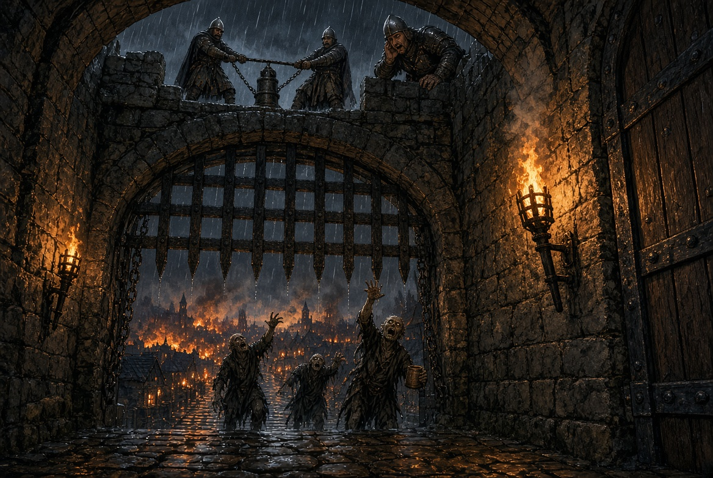

# 3. Fechem os Portões

**Local:** Portão do castelo, Wallace (Caithness)
**Hora:** Madrugada, quando o relógio do capítulo 2 chega ao fim
**Iluminação:** Tochas no muro, chuva fina. Nada de escuridão total — a luta é vista
**Imagem inicial:** `inicio.jpg`
**Mapa:** `cenarios/com-grid/castle-gate-portao.json`

## O que acontece

**A grade travou a meio metro do chão e não desce mais.**

Os mortos chegaram antes de ela fechar e se enfiaram por baixo — braços, ombros, cabeças,
corpos inteiros entalados no vão. O peso morto trava a corrente. Em cima, no guincho, dois
soldados puxam um ferro que não anda; embaixo, os guardas seguram três frentes ao mesmo
tempo, e são poucos demais para isso.

> *"Não desce! Tem coisa embaixo! TIREM ELES DE BAIXO DELA!"*

**Dez turnos.** É o que a corrente aguenta antes de arrebentar. O que a cena pede não é

matar — é **desentupir aquele vão antes que o ferro ceda**.

É uma cena curta, com um relógio que a mesa enxerga e um objetivo que cabe nele. E é a
primeira vez na campanha em que o grupo luta **por** alguma coisa em vez de fugir dela.

### O homem que decide

**Quem comanda este portão é Osric de Bannock** — o guarda que estava bebendo sozinho no

balcão d'A Âncora Quebrada no capítulo 1, e que subiu ao castelo com o que viu.

Isso importa mais que qualquer número deste capítulo. **Se houve morte na taberna, ele sabe
o nome de quem matou, e agora é ele quem decide quem entra.** Não vai negar o portão a
ninguém enquanto houver mortos no vão — Dever é a desvantagem dele, e a cidade vem antes.
Mas conta cada rosto, e a conta é cobrada no capítulo seguinte, com o Lorde William ouvindo.

**Se não houve morte na taberna**, ele reconhece os personagens como os que estavam lá e não

causaram problema: **+2** em toda reação dele durante o capítulo.

## Por onde cada um entra na cena

**A cena é a mesma para todos; o que muda é de que lado você chega.** Os personagens podem

estar em três lugares diferentes quando ela começa, e nada impede que estejam nos três ao
mesmo tempo — é bom que estejam.

**1. QUEM ESTÁ DO LADO DE FORA**, na rampa, com os mortos.

Chegou tarde, ou ficou para trás. A grade está a meio metro do chão e **a única entrada é
o vão de baixo** — o mesmo por onde os mortos estão entalados.

- **Rastejar por baixo** custa um turno inteiro e exige **DX-2**, ou Acrobacia. Sucesso põe
  o personagem dentro. Falha: fica preso no meio do caminho, **sem defesa ativa nenhuma até
  o próximo turno**. Falha crítica: fica preso *e* o grupo perde um turno para puxá-lo.
- **Não passa quem estiver com Carga acima de média**, nem com escudo grande nas costas.
  Larga ou fica — e largar no vão significa largar de vez.
- **Quem está de fora pode atacar os entalados por trás**, e é a melhor coisa que pode
  fazer antes de entrar: são alvos deitados que não se defendem e não o veem chegar.
  **+4** por atacar pelas costas um alvo que não o percebeu, e cada golpe conta para
  limpar o ponto.

**2. QUEM JÁ ESTÁ DO LADO DE DENTRO**, no vão do portal.

Chegou a tempo e passou. Está com os guardas, e é quem tem mais opções: pode segurar
qualquer uma das três frentes, puxar um caído, empurrar o vão com escudo, pôr fogo no óleo.

**Quem está dentro e não faz nada é visto não fazendo nada** — por Osric, pelos guardas e

pelos civis do pátio. Isso não tem número; tem consequência no capítulo 5.

**3. QUEM VEM PELO CANAL**, subindo do capítulo 2.

Emerge no poço do pátio de serviço, encharcado, e a primeira coisa que ouve, antes de
enxergar qualquer coisa, são **homens gritando por socorro do lado do portão**. Não é grito
de batalha: é gente pedindo ajuda pelo nome, e perdendo.

Ninguém vai pará-los no pátio, ninguém vai perguntar quem são. **Todo homem que podia
perguntar está no portão, e está perdendo.** Correr até lá custa **um turno**; eles entram
na cena no turno 2, por dentro, atrás da linha dos guardas.

E aí vale o que vale para todo mundo: **quem chega e assume uma frente paga a entrada na
hora.** Quem ouve os gritos e fica no pátio, também — de outro jeito, e o capítulo 5 lembra.

## O objetivo: seis pontos de trava

**A grade desce quando os pontos de trava são limpos, e há seis.** Cada ponto é um corpo

entalado que impede o ferro de correr.

| Pontos restantes | Onde a grade está |
|---:|---|
| 6 | Meio metro do chão — passa homem deitado, e é por aí que se entra |
| 4 | Um palmo e meio — passa braço e cabeça. **Ninguém mais entra de fora** |
| 2 | Um palmo — passa braço |
| 0 | **A grade toca o chão. Acabou.** |

**Limpar um ponto custa uma ação bem-sucedida naquele ponto** — o que conta como sucesso

depende da frente, e a tabela abaixo diz. **A cada 2 turnos, um morto novo se enfia num
ponto que ficou sem ninguém segurando**: limpar não basta, é preciso limpar e não deixar
voltar.

**Diga o número à mesa a cada turno**, na voz de Osric: *"quatro!"*, *"três!"*. O relógio

tem de ser visível — tensão vem de ver o tempo passar, não de adivinhá-lo.

## As três frentes

Cada uma premia uma arma diferente, e **é por isso que o grupo tem de se dividir**. Diga as
três à mesa antes do primeiro turno e deixe cada jogador escolher onde entra.

### 1. Por baixo — o vão sob a grade

Mortos rastejando pelo meio metro de folga. Alvo deitado, e o livro dá o número: **-4**
(`11-combate-avancado.md`, Cobertura e Esconderijo). Eles não se defendem.

- **Arma curta, chute e ponta funcionam:** faca, espada curta, adaga, bota.
- **Arma grande não funciona.** Montante, machado grande e maça precisam de balanço e não há
  altura. **-6 adicional** para quem insistir, ou simplesmente diga que não dá.
- Quem se **agacha ou deita** para alcançar leva **-2 nas próprias defesas** enquanto
  estiver assim. É uma troca, não um castigo — diga o preço antes de o jogador aceitar.

### 2. Pelos vãos da grade — as frestas entre as barras

Braços passando por entre o ferro, agarrando quem chega perto. Só a ponta alcança: **-5**,
interpolado da linha *"cabeça apenas"* da mesma tabela.

- **Só passa arma de ponta:** faca, espada curta de estocada, lança, virote, flecha.
- **Lâmina larga e machado batem na grade.** Não passam. Quem só tem isso não serve aqui.
- **O morto agarrado não se defende e não solta:** cada golpe conta, e **dois golpes
  bem-sucedidos no mesmo braço liberam o ponto**.
- **Alternativa sem arma:** **ST-2** para arrancar o braço entalado à força. Sucesso limpa
  o ponto; falha crítica, o morto puxa quem tentou contra a grade — atordoado por 1 turno.

### 3. A porta de serviço — o vão lateral do portal

A poterna ao lado do arco, que ninguém teve tempo de trancar. **Um hexágono de largura:**
passa um de cada vez, dos dois lados.

- **Combate normal, Sistema Avançado, sem redutor nenhum.** É a única frente onde se luta de
  pé e de frente, e onde arma grande vale o que custou.
- **Quem segura ali segura sozinho** — não cabe segundo. Em compensação o inimigo também vem
  um por vez, e quem tiver escudo e Aparar alto faz a noite inteira ali.
- **Se ninguém segurar a poterna, entram dois mortos por turno no pátio**, e lá dentro há
  civis.

## A cena, turno a turno

| Turno | O que acontece |
|---:|---|
| 1 | A linha se forma. Um morto-vivo **por personagem presente**, sorteados entre os tipos 1, 2 e 3 |
| 2 | Quem vem pelo canal chega. **Mais um morto** se enfia num ponto desguarnecido |
| 3 | A corrente geme alto. Osric grita o número de pontos que faltam, e passa a gritar a cada turno |
| 4, 6, 8 | **Mais um morto** por ponto desguarnecido |
| 5 | Se ainda houver 5 ou 6 pontos, **um guarda cai** — a frente dele abre |
| 7 | Com 4 pontos ou menos, a grade já desceu: **ninguém mais entra de fora** |
| 10 | **Fim.** Zerou os pontos, a grade fecha. Não zerou, a corrente arrebenta |

## Testes

| Situação | Perícia / Atributo | Sucesso | Falha | Falha crítica |
|---|---|---|---|---|
| **Rastejar por baixo** (entrar de fora) | DX-2, ou Acrobacia | Entra | Preso no vão, **sem defesa ativa** até o próximo turno | Preso, e o grupo gasta 1 turno para puxá-lo |
| **Limpar um ponto por baixo** | Combate, **-4** | O ponto cai | Nada muda | Arma entalada na grade: 1 turno para soltar, ou largue-a |
| **Limpar um ponto pela fresta** | Combate com arma de ponta, **-5** | Meio ponto — dois sucessos limpam | Nada muda | O morto agarra a arma e puxa: atordoado 1 turno |
| **Arrancar o braço à força** | ST-2 | O ponto cai | Nada muda | Puxado contra a grade: atordoado 1 turno |
| **Segurar a poterna** | Combate normal | Ninguém passa | Um morto entra no pátio | Dois entram, e um vai para os civis |
| **Empurrar o vão com escudo** | Escudo, ou disputa de ST | Abre folga: o próximo morto entra atrasado | Nada muda | Perde o equilíbrio: caído, 1 turno para levantar |
| **Fogo no vão** (óleo, tocha, palha) | Nenhum | **Limpa 1 ponto por turno, sem jogada** | — | — |
| **Puxar um caído para trás da linha** | ST-2, ou Escudo | Arrasta o companheiro | Não consegue; os dois expostos neste turno | Cai junto; ambos deitados |
| **Gritar por ajuda lá de cima** | Liderança ou Trovador | Um Guarda Vivo desce e assume uma frente | Ninguém vem; não há homem | Dois descem, **e é pior**: o vão aperta, -1 para todos por 2 turnos |

**Fadiga de batalha ao fim**, pelo nível de Carga +1 (MB pág. 134). Em dez turnos ela cobra

de verdade, e o grupo já chega cansado da avenida — some à conta que trouxerem.

## Os guardas, e o que acontece quando um cai

Quatro na linha, mais dois no guincho que não descem. Ficha de
[Guarda Vivo](../npcs.md#guarda-vivo).

- Cada guarda segura uma frente e **limpa um ponto a cada 3 turnos** sozinho.
- **Quando um guarda cai, um ponto volta** — a frente dele fica aberta até alguém assumir.
  É isso que faz a cena apertar sem o Mestre precisar inventar inimigo novo.
- **Eles não morrem enquanto houver personagem na mesma frente.** Caem inconscientes e são
  arrastados. **Morre guarda que ficou sozinho** — e a mesa vê a diferença que fez estar ali.

## Como a cena termina

- **Zerou os seis pontos:** a grade desce de uma vez, com o peso todo. O que estiver no vão
  é esmagado, e o barulho disso é o fim do capítulo. **Nenhum personagem está no vão** —
  descreva o último puxão que tira o herói de lá e não role nada.
- **Chegou ao turno 10 sem zerar:** a corrente arrebenta sozinha, de fadiga, e **a grade
  fica presa nos corpos** — desce meio palmo e para. Não fecha mais nesta noite. O castelo
  entra no capítulo 4 com o portão escorado por barricada improvisada e **-2 em tudo que
  depender da muralha**. Não mate ninguém por isso; **o castelo é que paga**.
- **O elo foi cortado de propósito:** desfecho diferente do acima, e é o único do capítulo
  que pode matar personagem. Veja **Cortar a corrente**.

## O que não pode acontecer

**Ninguém morre neste capítulo.** É a terceira cena da campanha e o grupo ainda está se

conhecendo; matar aqui é barato e caro ao mesmo tempo.

- **Quem ficar do lado de fora quando a grade fechar não está perdido:** os soldados jogam
  cordas da muralha e o herói se amarra para subir.
- **Quem ficar inconsciente é puxado no turno seguinte** — arrastado para trás da linha ou
  içado na corda, fora do alcance de tudo.
- **Diga as duas coisas à mesa antes de alguém cair.** Sem isso a cena vira desespero em vez
  de tensão, e desespero faz jogador jogar mal e reclamar depois.

O que *pode* acontecer é ferimento que fica, arma perdida no vão e um herói acordando no
pátio sem lembrar como chegou lá. Isso é bom. Morte, não.

## Se os jogadores fizerem outra coisa

- **Entrar correndo e deixar a linha.** Osric deixa — ninguém briga com aliado num momento
  desses. Mas ninguém limpa ponto nenhum: a corrente arrebenta no turno 10 e **três mortos
  entram no pátio**. A luta acontece de qualquer forma, só que pior: dentro do castelo, com
  civis em volta e sem muro nas costas. **Não é punição, é consequência — deixe explícito**,
  e deixe antes, não depois.
- **Fogo, óleo, barricada.** Recompense generosamente. Óleo em chamas no vão limpa um ponto
  por turno **sem teste nenhum**. É exatamente o que jogadores devem inventar, e a resposta
  certa é *"funciona"*. Há barris no pátio de serviço, e Osric os entrega se alguém pedir.
- **Um personagem segurar uma frente sozinho enquanto os outros limpam.** Heroico e viável.
  Dê a ele todos os mortos daquela frente e todos os aplausos, e **não o mate**.
- **Negociar em vez de lutar.** Não há com quem: os mortos não falam e Osric não tem o que
  oferecer. Quem tentar perde o turno e ouve isso na cara.
- **Cortar a corrente para a grade cair de uma vez.** Ideia boa, perigosa, e a resposta é
  *sim* — mas não é um golpe só. Veja **Cortar a corrente**, abaixo.

## Cortar a corrente

Mais cedo ou mais tarde alguém olha para o guincho e pergunta por que não se corta logo
aquilo. A resposta é que **funciona, e é terrível** — e as duas coisas têm de ficar claras
*antes* de o jogador rolar.

**Onde ela fica:** o guincho e a corrente estão em **P6**, encostados na muralha do lado de
dentro, ao lado do soldado ferido. **Não é no vão** — quem for cortar sai da linha e
atravessa o pátio até lá, e cada turno gasto no caminho é um turno fora da luta. Em
compensação, quem corta não está sob ataque: ali não chega morto nenhum enquanto a grade
segurar.

Resolva pelas regras de **Ataque a Objetos Inanimados** (`11-combate-avancado.md`, pág. 125
do MB). O alvo não é "a corrente": é **um elo**.

| | |
|---|---|
| **Alvo** | Um elo da corrente do guincho — **RD 3, 20 pontos de vida** (barra de ferro de 1 polegada, que é do que essas correntes são feitas) |
| **Arma indicada** | **Machado ou martelo/maça.** Lâmina larga serve mal e fica cega; faca, lança e ponta não servem — o livro manda usar bom-senso sobre o que pode afetar o objeto |
| **Defesa** | **Nenhuma.** Objeto inanimado não tem jogada de defesa |
| **+4** | Se gastar **um turno inteiro apontando** contra o objeto imóvel, como o livro concede |
| **+2** | A corrente está sob tensão máxima, com o peso todo da grade puxando. Decisão do Mestre, e é física: cabo esticado corta mais fácil que cabo frouxo |

**O detalhe que decide tudo:** contra objeto, *"golpes com armas cortantes e perfurantes não

recebem bônus de dano — eles se aplicam somente a alvos vivos"*. **O ×1,5 do corte não
vale aqui.** Um machado grande que faria 2d+2 e viraria 15 num pescoço faz 2d+2 e vira **9**
num elo — menos a RD 3, sobram 6.

Na prática: **três a quatro turnos de machado**, e cada um deles é um turno que aquele
personagem não está limpando ponto nem segurando frente. É um investimento, não um botão.

### O que acontece quando o elo arrebenta

**A grade cai de uma vez, com o peso inteiro, sem nada segurando.**

- **Fecha.** Todos os pontos de trava são resolvidos ao mesmo tempo, e o capítulo acaba
  nesse instante. O portão está fechado e o castelo está inteiro.
- **E esmaga tudo o que estiver no vão.** Os mortos entalados, sim. **E qualquer personagem
  que esteja limpando por baixo, ou rastejando para entrar, ou caído ali.**
- **Quem estiver do lado de fora fica do lado de fora**, e não há mais vão nenhum: só a
  corda, e a corda vem depois, com a rampa cheia.

### Como arbitrar isto sem estragar a mesa

1. **Avise antes do primeiro golpe**, em voz alta e sem rodeio: *"se o elo arrebentar, a
   grade cai inteira, e quem estiver embaixo morre."* Não é dica, é a informação que
   qualquer um daqueles personagens teria olhando para aquilo.
2. **Conte os pontos de vida do elo à vista da mesa**, como Osric conta os pontos de trava.
   *"Seis. Faltam catorze."* Isso dá aos outros jogadores tempo de sair de baixo — ou de
   discutir com quem está cortando, que é a cena boa.
3. **Honre o que decidirem.** Se cortarem com um companheiro embaixo, a grade cai. Esta é a
   única situação do capítulo em que **um personagem pode morrer**, e ela existe porque a
   mesa escolheu, sabendo, contra o aviso. Não a tire deles.
4. **Os guardas gritam para não cortarem.** Osric mais alto que todos: aquela corrente é do
   castelo, e sem ela o portão não abre nunca mais — o que é problema do capítulo 14, e ele
   sabe disso mesmo agora.

## O que o grupo leva daqui

O capítulo 4 começa em cima da muralha, e **o saldo desta cena decide como o grupo é tratado
lá**:

| Como saiu daqui | O que vale nos capítulos 4 e 5 |
|---|---|
| Zerou os pontos e fechou a grade | **+2** de reação com toda a guarnição, e o Lorde William ouve o nome deles antes de vê-los |
| Segurou, mas a corrente arrebentou | Neutro. Fizeram o que deu, e o castelo sabe — e o castelo paga o preço no muro |
| Veio pelo canal e foi para a linha | **+2** com a guarnição, e Osric devendo um favor pessoal a quem assumiu a frente dele |
| Ouviu os gritos e não foi | **-3** de reação. Entra na conversa do capítulo 5, pela boca de quem estava lá |
| Entrou correndo e largou a linha | **-1**, e trabalho no muro antes de falar com quem manda |

Somem-se a isso os civis que o grupo tenha salvado no caminho, se os trouxe: **eles contam o
que viram**, e isso anula um grau de reação ruim em qualquer das linhas acima.

**A guarnição continua sem saber do canal**, e isso importa nos capítulos 5 e 6: é uma saída

do castelo que ninguém vigia. Ninguém vai perguntar por onde entraram numa noite dessas —
mas se alguém do grupo contar, põem um homem lá e a porta se fecha.

## NPCs

**Osric de Bannock** (chefe da guarda) e **Guarda Vivo** — fichas em [`npcs.md`](npcs.md).
**Morto-Vivo 1, 2 e 3** — em [`../npcs.md`](../npcs.md).

**Osric está na linha, com todos.** Já não há a quem dar ordens: os dois homens do guincho

puxam a corrente e o resto está no vão. Ele grita o número de pontos que faltam, manda jogar
corda e luta como os outros. Se cair, **um ponto volta** como o de qualquer guarda — e aí a
mesa descobre que o homem que os julgava era também o que os estava segurando.
