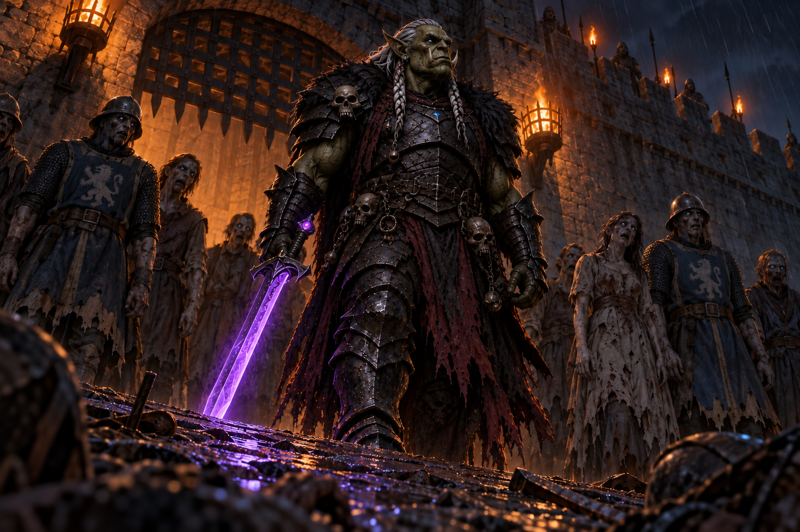

# 4. O Que Não Enterra

**Local:** Muralha e rampa do portão do castelo, Wallace (Caithness)
**Hora:** Madrugada, minutos depois de o portão fechar
**Iluminação:** Tochas no adarve, chuva fina. Lá embaixo, só o que a luz alcança
**Imagem inicial:** `inicio.png`

**Esta cena não é para ser vencida. É para ser esticada.**

O capítulo 3 foi uma luta que o grupo ganhou pagando caro. Este não é luta nenhuma: é uma
conversa por cima de um portão fechado, e **o objetivo é fazê-la durar o máximo possível**.

Quando o orc chama pelo nome do lorde, **William desce do adarve, chega perto dos
personagens e diz baixo, sem olhar para eles**:

> *"Precisamos ganhar tempo. Façam esse bicho falar."*

E sobe de volta para responder.

**É isso o capítulo.** Cada minuto que os personagens arrancarem de Vurkash é um minuto que
o castelo usa para se preparar, e **o total que eles juntarem aqui vira modificador no
capítulo 6**. Ninguém precisa vencer o orc: precisam entediá-lo, lisonjeá-lo, negociar
condições, perguntar da família dele — qualquer coisa que o mantenha falando.

## Por que o tempo importa

**Não diga isto de saída.** Deixe que perguntem, e aí William responde em três frases, do
alto da muralha, entre uma resposta e outra ao orc:

> *"Tem uma passagem que sai no estábulo de fora. Meu avô mandou fechar quando eu era menino e ninguém
> desce lá há vinte anos — está entulhada de pedra, viga podre e terra. **Eu tenho dois
> homens cavando desde que a grade caiu, e eles precisam de tempo.** É só isso que eu
> preciso de vocês."*

| Tempo acumulado | Em que pé fica a passagem |
|---|---|
| **Até 30 min** | Só o alçapão. Os dois ainda estão tirando a pedra de cima |
| **1 hora** | O poço limpo e o túnel aberto, mas só **um de cada vez, agachado** |
| **1 h 30** | **Passam três de frente, em pé.** O castelo esvazia depressa |
| **2 horas** | Escorada e larga: dá para levar cavalos pela rédea, um a um |
| **Mais de 2 h** | Rampa aberta na boca. **Até a carroça desceria** |

**A passagem é larga de verdade** — foi cavada para escoar uma guarnição, não para um
homem fugir. O que o tempo decide não é se ela passa, é **quantos de frente**.

**Ninguém dentro do castelo sabe disto além de William e dos dois homens** — nem a
guarnição. Um personagem que sonde os soldados pode descobrir *que existe uma passagem*;
descobrir *que estão cavando nela agora* é outra coisa, e só William entrega.

**Este número é o produto do capítulo.** Anote-o e leve para o capítulo 6.

## O que acontece, em ordem

### 1. Vurkash chama, e William responde

A horda **abre caminho** — e isso é mais assustador do que quando ela batia no ferro.
Vurkash sobe a rampa **sozinho**, armadura negra, olhos azuis, a espada de brilho roxo no
quadril e não na mão. Para a dez metros do portão, olha para o alto e chama em ânglico bom
demais para um orc:

> *"WILLIAM DE WALLACE. EU SEI QUE VOCÊ ESTÁ AÍ EM CIMA."*

### 2. A oferta, e ela é verdadeira

> *"Abram o portão. Entreguem o homem gordo. Todo o resto sai vivo pela estrada do sul e eu
> não sigo ninguém. **Eu não sei quantos vocês são aí dentro. Você também não.** E nenhum
> deles tem nada a ver com isso."*

**A oferta é verdadeira**, e este é o ponto do capítulo. Vurkash não mente aqui e não
mentirá em nenhum momento da campanha — ele veio por um homem só e cumpriria o trato. O
Mestre sabe disso; a mesa não.

**Deixe a oferta no ar por um instante longo.** Alguém vai olhar para o lorde. É para olhar.

### 3. O pedido de William

É aqui que ele desce, diz a frase aos personagens e sobe de volta. **A partir deste
momento o relógio corre** — e quem o faz correr são os jogadores.

### 4. A prova, quando o Mestre precisar apertar

No fim da terceira rodada de conversa, ou quando a mesa ficar confiante demais, Vurkash
**caminha até um dos soldados caídos na rampa**, que a mesa reconhece do capítulo 3, e o
mata com um golpe. Sem jogada. No turno seguinte **o homem se levanta**.

> *"Eu não preciso da porta, William. Eu tenho tempo. **Você é que tem gente demais lá
> dentro para contar.**"*

**Verificação de Pânico para todos** — ver *Testes*. E **a conversa continua**: a prova não
encerra a cena, ela lembra a todos por que estão negociando.

### 5. A frase que abre o capítulo 5

Quando a paciência acabar, antes de descer, ele diz uma coisa que só faz sentido para
William, e a mesa ouve:

> *"Você já a segurou. Eu sei que já. E você devolveu."*

**William não responde.** Sai da ameia sem dizer mais nada, e é a primeira vez na noite em
que alguém o vê sem palavra.

## Como se compra tempo

**Uma tentativa por personagem por rodada de conversa.** Cada tentativa é um **Teste de
Influência** (MB, cap. 12): *"uma disputa de Perícia vs. Vontade"* — a perícia do
personagem contra a **Vontade 13** de Vurkash.

| Resultado | O que ganha |
|---|---|
| **Sucesso decisivo** | **20 minutos**, e o próximo da mesa ganha **+1**: o orc está gostando da conversa |
| **Sucesso** | **10 minutos** |
| **Empate** | **5 minutos**. Ele responde por educação |
| **Falha** | Nada, e **-1 na paciência dele** |
| **Falha crítica** | Nada, **-3 na paciência**, e ele responde *pelo nome* — o personagem descobre que o orc sabe quem ele é |

### As sete dinâmicas, e cada uma tem um preço

| # | A abordagem | Perícia | Mod. | O que rende a mais |
|---|---|---|---|---|
| **1** | **Bajular o feito dele** — a cidade inteira, sozinho, sem perder um homem | Lábia, Atuação, Trato Social | **+2**: é vaidoso e tem Fanfarronice | Ele se alonga. **Some 5 minutos** ao resultado |
| **2** | **Pedir a história do irmão** — por que William, e não a coroa? | Trato Social, Diplomacia, Psicologia | **+1** se perguntarem com respeito | Ele **conta tudo**, e de graça: é a informação que William cobra caro no capítulo 5 |
| **3** | **Negociar as condições da entrega** — por qual estrada, quem sai primeiro, quem garante | **Mercador**, Diplomacia, Direito | — | A mais natural e a que mais rende: **cada condição nova** é uma tentativa nova |
| **4** | **Exigir prova de que ele cumpre** — um refém, um juramento, um gesto | Trato Social, Teologia, Liderança | **-1**: ele se ofende com a dúvida | Sucesso: ele **faz** o gesto, e isso custa tempo real a ele |
| **5** | **Apelo religioso** — um clérigo invocando o que quer que seja | Teologia, Trato Social | **-2**: ele não acredita em nada disso | Mas **escuta**, porque nunca ouviu esse argumento. Sucesso decisivo aqui vale **30 minutos** |
| **6** | **Fingir que vão aceitar** — enrolar sobre como abrir o portão | Lábia, Atuação | **+1** | **William ouve.** Ver *O risco de cada caminho* |
| **7** | **Perguntar da espada** | qualquer uma | — | **Não rende tempo nenhum.** Ele muda de assunto, e é a única vez na campanha em que se esquiva. Quem perguntou **ganha a informação** de que aquilo é assunto proibido |

**Abordagem repetida perde força**, pela regra de segunda tentativa do livro (MB, pág. 180):
**-2** na segunda vez que a mesa usar a mesma dinâmica, **-4** na terceira. É o que obriga o
grupo a variar, e é o coração do capítulo.

### O que encurta o tempo

| O que um personagem faz | Efeito |
|---|---|
| Chamá-lo de *bicho*, *animal*, *orc* | **+2 na Vontade dele** naquela tentativa, e **-1 na paciência** |
| Atirar nele | **-3 na paciência**, imediato. Ele nem olha |
| Ameaçar | **-2 na paciência**. Ele acha graça, e a graça é curta |
| Mentir e ser pego | Ele não mente e não perdoa mentira: **-3 na paciência** e **+2 na Vontade** contra aquele personagem pelo resto da cena |
| Ficar calado a rodada inteira | Nada. Não é punido, mas não rende |

## O relógio de Vurkash

**Ele não é burro, e o Mestre não deve fingir que é.** Ele sabe que está sendo enrolado; o
que não sabe é por quanto tempo ainda vale a pena.

**Paciência: 10 pontos.**

| Quando | O que muda |
|---|---|
| **Fim de cada rodada de conversa** | **-1**, sempre |
| Falha numa tentativa | **-1** |
| Falha crítica, tiro, ameaça, mentira descoberta | **-3** |
| Ele faz a prova (matar e levantar o soldado) | **+2** — a demonstração o acalma; ele acha que convenceu |
| Sucesso decisivo de qualquer personagem | **+1** |

**Em 0 ele vira as costas**, diz a frase do capítulo 5 e desce. A cena acaba, e o tempo
acumulado é o que é.

**Diga o número em voz alta a cada rodada**, na voz dele: *"Estou começando a achar que
vocês estão me enrolando."* A tensão vem de a mesa **ver** a paciência acabando, como via
os turnos da corrente no capítulo 3.

## Testes

| Situação | Perícia / Atributo | Sucesso | Falha | Falha crítica |
|---|---|---|---|---|
| **Comprar tempo** | a perícia da dinâmica **vs. Vontade 13** | ver a tabela | nada, e -1 na paciência | -3 na paciência, e ele o chama pelo nome |
| **Ver o soldado se levantar** | **Verificação de Pânico** (Vontade). Reflexos em Combate **+2**; **Calor da Batalha +5 só para quem ainda estava lutando** | segue normal | 3d + a margem, na Tabela de Verificação de Pânico (MB, pág. 94) | idem, e costuma dar Peculiaridade ou Fobia nova |
| **Perceber que a oferta é sincera** | Detectar Mentiras, Psicologia, ou IQ-2 | **Ele não está blefando.** Muda tudo o que a mesa pensa da cena | Acha que é armadilha | Convence-se de que é armadilha, e joga pior |
| **Ouvir o que William não nega** | Detectar Mentiras, ou IQ-3 | O lorde **não negou a última frase** | Nada | Acha o lorde inteiramente franco |
| **Contar os mortos na rampa** | Estratégia, Tática ou IQ | São **muito mais** do que atacaram o portão. Ele estava segurando | Nada | — |
| **Reparar na espada** | Percepção-2, ou Conhecimentos de Magia | O **brilho roxo pulsa quando ele fala dos mortos**, não quando os mata | Nada | — |

## O risco de cada caminho

**Fingir que vão aceitar é a melhor jogada e a mais cara.** Rende bem, e **William ouve cada
palavra**. Ele é estrategista com Tática 14 e entende que é blefe — mas o castelo inteiro
também ouviu, e nem todo mundo entendeu.

| Quem falou | O que acontece depois |
|---|---|
| Um personagem só, e ficou claro que era manobra | Nada. William agradece no capítulo 5 |
| Um personagem, e soou sincero demais | **-2 na reação de William** com ele, e um guarda repete a frase para outro |
| Mais de um, insistindo | **-3**, e a história chega ao capítulo 5 **antes** dos personagens |

**Quem aceitar de verdade** — não fingir, aceitar — muda a campanha, e o Mestre deve honrar.
Vurkash cumpriria. O que **não** acontece é o portão abrir sozinho: a corrente do guincho
foi destruída no capítulo 3, e erguer aquela grade é trabalho de uma hora e de muitos braços
que ninguém vai emprestar.

## O que não pode acontecer

**Vurkash não pode ser derrotado aqui, e não deve ser ferido de forma visível.**

- **Deixe a mesa testar uma vez.** Uma flecha, uma pedra, um virote. Aplique o dano,
  descreva o impacto, e faça ele **não reagir**. Custa um dado e três pontos de paciência,
  e é a informação mais importante do capítulo.
- **Ninguém desce.** Quem insistir em ir à rampa depois do aviso morre, e o jogador entra
  com outro personagem entre os sobreviventes. **Dê o aviso antes**, pela boca de William.
- **A cena não vira combate.** Se a mesa forçar, Vurkash simplesmente **vai embora** com a
  paciência zerada, e o castelo perde todo o tempo que não comprou. Não é punição, é
  consequência — e diga antes.

## Se os jogadores fizerem outra coisa

- **Ninguém fala nada.** A cena funciona igual, e é o pior desfecho: **zero minutos**.
  Vurkash conversa só com William, a paciência cai sozinha, e o capítulo 6 começa com o
  castelo sem água. Não force participação; deixe o silêncio custar.
- **Perguntar a Vurkash o que William fez.** É a dinâmica 2, e ele responde com prazer.
  **Vurkash entrega de graça o que William cobra caro** — a mesa deve perceber isso.
- **Mandar alguém preparar a fuga em vez de conversar.** Excelente, e vale: cada personagem
  que sair do adarve para ajudar no pátio **converte o próprio turno em 15 minutos fixos**,
  sem jogada. Menos vozes no muro, mais mãos embaixo. É uma troca legítima.
- **Tentar descobrir de onde veio a espada.** Dinâmica 7: não rende tempo, rende informação.
  Anote quem perguntou; vale no capítulo 10, com Eriel.
- **Propor duelo singular** — um campeão do castelo contra ele. Ele **aceita na hora**, e
  isso **zera a cena**: é o capítulo 8 com sete capítulos de antecedência, e o campeão morre.
  Se a mesa insistir depois do aviso, honre.

## O que o grupo leva daqui

1. **Os minutos comprados**, que são o produto do capítulo e entram no capítulo 6.
2. **Vurkash quer um homem, não a cidade** — e disse isso na frente de todo o castelo.
3. **Ele cumpre o que promete.** Nada nesta cena o desmente, e nada o desmentirá depois.
4. **A história do irmão**, se perguntaram — de graça, e antes de William a contar.
5. **William escondeu alguma coisa**, e quem rolou Detectar Mentiras sabe disso **antes**
   de o lorde abrir a boca no capítulo 5.
6. **A espada é assunto proibido**, para quem tentou.

## NPCs

Ver [`npcs.md`](npcs.md).
