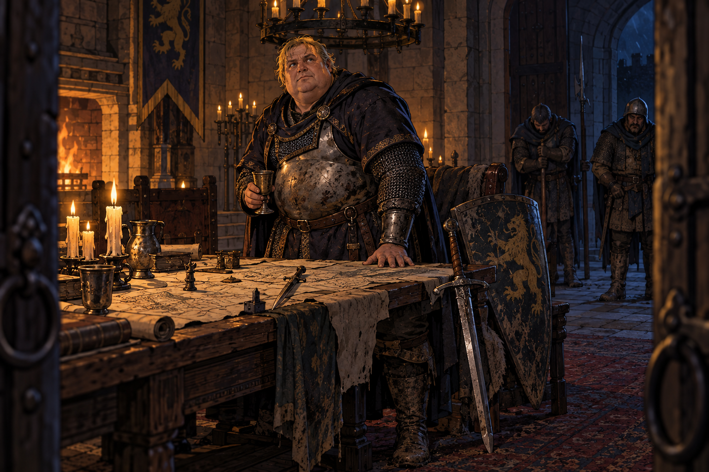

# 5. O Lorde William

**O capítulo mais importante da campanha**, e o único em que o resultado de um dado
precisa ser anotado para uso posterior.

**Imagem inicial:** `william-de-wallace.png`



*O Lorde William de Wallace no salão do castelo, na noite em que Wallace caiu.*


## Como o capítulo começa: o aríete

**Antes de qualquer conversa dentro do castelo, a mesa vê isto do alto da muralha.**

Vurkash não volta a falar. Ele para no meio da rampa, levanta a mão, e a horda — que até
agora batia no ferro como bicho — **para de bater e começa a trabalhar**.

Derrubam uma casa da rua de baixo e arrastam a viga-mestra. Trazem corda, rodas de
carroça, um eixo. **Não há gritaria e não há pressa**, e é por isso que assusta: são
dezenas de mãos mortas fazendo carpintaria em silêncio, no escuro, na chuva.

> *"Eu disse que não precisava da porta, William. Eu menti sobre uma coisa só: eu preciso,
> e eu tenho tempo de fazer uma."*

**É a única frase falsa que Vurkash diz na campanha inteira**, e ele mesmo a marca como
tal. Quem notar tem material para o capítulo 8.

**Prompt da ilustração do aríete** (`ariete.png`):

```
Digital illustration, fantasy RPG scene art, clean linework with warm soft coloring, hand-drawn look. Night, thin rain, a castle gatehouse in Caithness seen from the battlement above and to one side: a heavy iron portcullis already dented, torchlight on wet stone. On the stone ramp below, dozens of corpses in muddy peasant clothes and broken soldiers' mail heave a massive roof beam lashed with rope to a crude cradle of cart wheels. They work in silence and in step, faces slack, none of them looking up. The beam is mid-swing, a hand's breadth from the iron. Further back on the ramp, alone and not helping, an orc in black plate with a greatsword glowing faint purple at his hip watches the grate, not the wall. Wide shot, high angle from the wall. No text, no lettering, no signage.
```

### O relógio

|                      |                                                         |
| -------------------- | ------------------------------------------------------- |
| **Montar o aríete**  | **15 minutos.** São muitas mãos e elas não descansam    |
| **Derrubar a grade** | **cerca de 30 minutos** de golpes, a partir daí         |
| **Depois disso**     | A grade cai e a horda entra. **Não há defesa possível** |

**Não há nada que a mesa possa fazer para atrasar isso, e o Mestre deve deixar isso
claro.** Flecha, fogo, pedra: os mortos não se importam, não se cansam e se substituem. O
tempo de conversa acabou no capítulo 4 — **o que se compra aqui não é tempo, é distância**.

**Diga os minutos em voz alta e repita**: *"a viga já está no eixo"*, *"o primeiro golpe
bateu, e vocês sentiram no chão"*, *"faz dez minutos que não para"*. A cena inteira do
capítulo 5 acontece com esse barulho por baixo.

### Para que serviu o tempo do capítulo 4

**Não era água nem carroça.** William pôs **dois homens** a cavar a passagem que sai no estábulo de fora
no instante em que a grade desceu — um túnel que o avô dele mandou fechar e que ninguém
abre há vinte anos, entupido de pedra, viga podre e terra.

Ele não disse isso a ninguém, nem aos personagens, nem à guarnição. **Era isso que ele
estava comprando, minuto a minuto, enquanto o orc falava.**

Consulte a tabela do capítulo 4 e diga à mesa em que pé a passagem está quando este
capítulo começa. **A passagem é larga** — foi cavada para escoar uma guarnição inteira —,
então o que o tempo decide não é se ela passa, é **quantos de frente**, e portanto quão
depressa o castelo esvazia.

### O que isto muda no resto do capítulo

- **William não enrola.** Ele conta tudo depressa, porque o martelo está batendo — e a
  pressa **esconde as omissões dele**: quem quiser sondá-lo leva **-2**.
- **A fuga deixa de ser sugestão e vira ordem.** O lorde não propõe o deserto: manda.
- **A passagem secreta é a única saída**, e quem já a conhecer tem a mão na mesa.
- **Quarenta e cinco minutos é o orçamento inteiro do capítulo 5.** O que não for feito
  até lá não é feito.

## O que acontece

Dentro do castelo, os personagens encontram **o Lorde William de Wallace** (*GURPS
Fantasy*, pág. 72). Ele está armado, sujo, no comando, e recebe os personagens
pessoalmente — o que já diz que a situação é grave.

**NÃO role o teste de reação aqui.** Ele é feito no **capítulo 4**, quando William desce ao
pátio e fala com os personagens pela primeira vez — é lá que está o primeiro contato cara a
cara. Leia o resultado em `campanha/04-o-que-nao-enterra/reacoes.json` e use-o: Ele vai reger boa parte do

jogo: é o quanto os personagens confiarão em William até a traição do capítulo 9.

William explica, e tudo o que ele diz é **verdade**:

- O orc se chama **Vurkash, o Que Não Enterra**, e é conhecido na fronteira — não como chefe de tribo, mas como o orc que os próprios orcs expulsaram.
- Ele deve ter posto as mãos em **algum objeto encantado** que lhe dá poder sobre os
  mortos.
- Vurkash **busca vingança contra William**, por algo antigo e que William não detalha.
  *(Se pressionado com Trato Social ou uma reação muito boa: William matou o irmão de
  Vurkash numa incursão, anos atrás, e o corpo nunca foi devolvido.)*
- Vurkash **dizimou a cidade sozinho**. Ele é muito poderoso.
- **A única chance é fugir para o Grande Deserto.** Lá não existe mana; nenhum objeto
  encantado funciona; os mortos-vivos serão destruídos se tentarem entrar.

## A negociação: ele quer a ajuda de graça

**William não pede favor — ele negocia**, e é a primeira vez na campanha em que a mesa vê
o estrategista funcionando de perto. Ele precisa dos personagens para segurar a linha
enquanto a passagem esvazia, e **vai tentar conseguir isso sem prometer nada**.

O argumento dele é sempre o mesmo, e é bom: *vocês também estão presos aqui dentro.*

> *"Eu não estou contratando ninguém. Eu estou dizendo onde é a porta. Quem quiser
> atravessá-la comigo é bem-vindo, e quem quiser esperar aqui também é livre."*

### Como resolver

**Uma disputa só, decidida numa jogada de cada lado.**

| Lado | Rola |
|---|---|
| **Os personagens** | O **melhor NH social da mesa** — Trato Social, Mercador, Diplomacia, Lábia, Trovador — de quem assumir a negociação |
| **William** | **Trato Social 13** (Diplomacia 13 serve igual; use o que a cena pedir) |

**Cada outro personagem pode somar +1**, até o teto de **+3**, se disser em voz alta um
argumento novo e concreto — não "eu ajudo", mas *"nós seguramos a grade enquanto seus
homens cavavam"*. Argumento repetido não conta.

| Situação | Mod. dos personagens |
|---|---|
| Sabem da passagem **antes** de ele oferecer | **+3** — ele perde a única moeda que tinha |
| Estão feridos e ele viu | +1 |
| Já salvaram um homem dele, com nome | +1 |
| Alguém falou em entregá-lo ao orc nesta noite | **-3** |
| Alguém o humilhou em público | **-2** |
| Um clérigo da fé dele conduz a conversa | +1 |
| Ameaçam ficar de fora se não houver pagamento | +2 na jogada, **-2 na reação dele daí em diante** |

### O desfecho

| Quem vence | O que acontece |
|---|---|
| **William** | **Ajuda de graça.** Ele agradece com elegância, promete "não esquecer" e não põe número nenhum. A promessa é sincera e vaga, que é o pior tipo |
| **Empate** | Ele cede o que não custa: **as montarias e o que houver de mantimento**, e nada em moeda |
| **Personagens, margem 1-4** | **$200 por cabeça**, pagos no ato, do cofre da guarnição |
| **Personagens, margem 5-9** | **$500 por cabeça**, mais montaria e provisão para a travessia |
| **Personagens, margem 10+** | **William,.000 por cabeça** e uma **carta lacrada** com o selo dele: terra em Wallace quando a cidade for retomada. Ele assina na frente de todos |

**Ele paga.** Não regateia depois, não some, não trai a palavra — e é exatamente por isso
que a mesa vai confiar nele até o capítulo 9. **O ouro dele é honesto; o que ele fará com
a espada é que não é.** Não estrague isso com uma esperteza barata aqui.

**Falha crítica dos personagens:** ele nota a ganância na hora errada e diz por quê, alto,
com a guarnição ouvindo. **-2 na reação dele com todo o grupo** e a fama pega.

**Sucesso decisivo de William:** além da ajuda de graça, alguém da mesa se oferece antes
de ser pedido — o personagem do jogador que estiver interpretando melhor. Não force; se
ninguém morder, trate como sucesso normal.

### O que registrar depois

- O valor combinado, em `campanha.py bolsa --pj ... --valor +N`, e o lado dele com `--npc`.
- A carta lacrada, se houve, como `anotar --coisa` — **ela volta no capítulo 14**.
- Quem conduziu a negociação: William lembra, e isso pesa no capítulo 9.

## Testes

| Situação                                   | Perícia / Atributo                         | Sucesso                                     | Falha                        | Falha crítica                                    |
| ------------------------------------------ | ------------------------------------------ | ------------------------------------------- | ---------------------------- | ------------------------------------------------ |
| **Reação a William**                       | **Já rolada no cap. 4** — não role de novo | O valor de lá rege a confiança até o cap. 9 | —                            | —                                                |
| Arrancar de William a história com Vurkash | Trato Social, ou reação Boa+               | Conta o do irmão morto                      | Desconversa: "assunto velho" | Ofende-se; -2 em toda reação futura com ele      |
| Perceber que William omite algo            | IQ-3, ou Detectar Mentiras-2               | Sente que a história do irmão não é tudo    | Nada                         | Convence-se de que William é inteiramente franco |

**O que William realmente omite:** ele já viu a espada de perto, antes desta noite, e já a

quer. Não diga isso a ninguém, nem mesmo num sucesso decisivo — o máximo que um sucesso
dá é a sensação de que há mais.

## NPCs

**Lorde William de Wallace** — *GURPS Fantasy*, pág. 72. Ficha e notas em

[`npcs.md`](npcs.md).

Interprete-o como um bom senhor em uma noite terrível: decidido, generoso com os
personagens, cuidando dos feridos, dizendo os nomes dos soldados mortos. **Quanto mais os
jogadores gostarem dele agora, melhor o capítulo 9 funciona.**

## Se os jogadores fizerem outra coisa

- **Não confiar nele desde já** (reação ruim) — ótimo. Deixe-os desconfiar sem ter razão
  nenhuma para isso ainda; a traição depois valida a desconfiança e eles vão adorar.
- **Propor voltar e lutar** — William recusa com argumento sólido: Vurkash levanta cada morto,
  então cada baixa engorda o inimigo. Matemática, não covardia.
- **Perguntar por que o deserto não tem mana** — ninguém sabe. É assim desde sempre. Os
  anões dizem uma coisa, os magos dizem outra, e nenhuma delas ajuda hoje à noite.
- **Querer levar os civis** — William concorda com os que puderem cavalgar. Isso muda o
  capítulo 7: some civis ao grupo, e a velocidade do grupo é a do mais lento.
